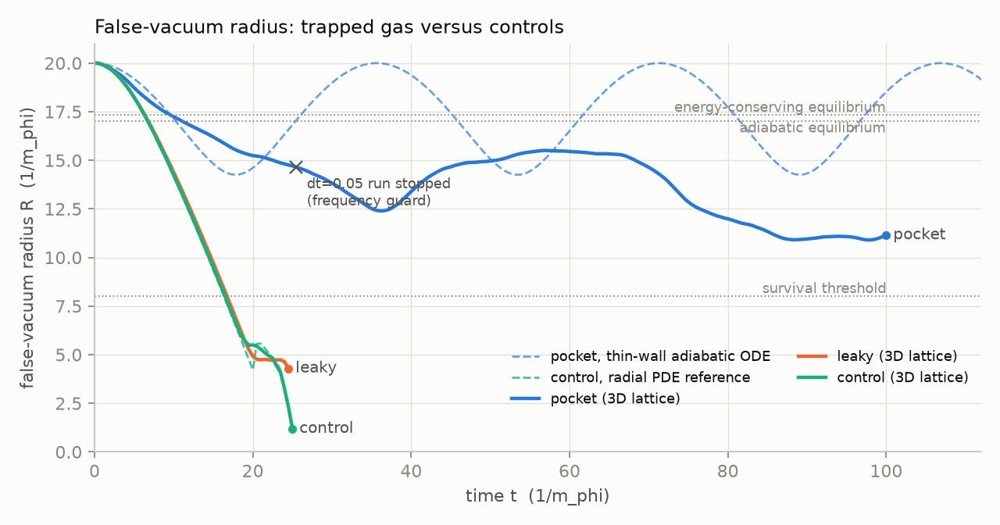
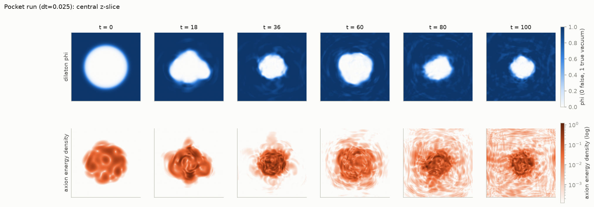
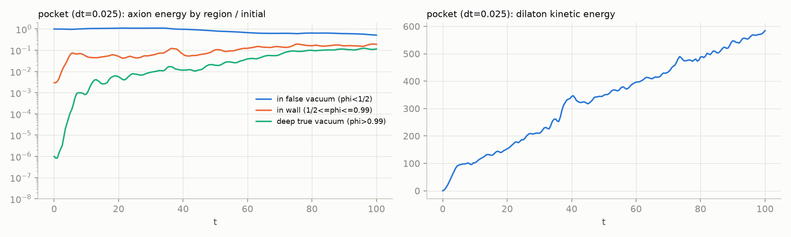
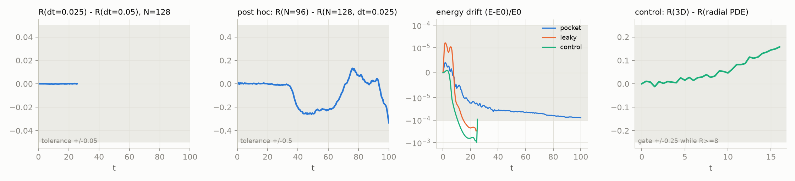

# Prototype-01: one breathing pocket with axion backreaction

Contract: [EXPERIMENT.md](../EXPERIMENT.md), written before the runs. Raw runs
are in `outputs/pockets/prototype-01/`, `outputs/pockets/prototype-control-02/`
and `outputs/pockets/validation-01/`; figures come from `outputs/pockets/plots-02/`.
JSON summaries are copied into [prototype-01/](prototype-01/). The animation
`outputs/pockets/plots-02/pocket.gif` is not committed.

Scope: the run starts from a ready-made pocket. It tests whether axion
backreaction keeps a false-vacuum region alive, not whether pockets form.

## Verdict against the predeclared contract

**Not a relic pocket by the contract.** The predeclared pocket run (dt=0.05)
stopped on the solver's frequency guard at t=25.5, so the late window
200<=t<=300 was never reached. The guard is a 0.5 margin on dt times the
largest local frequency; local axion amplitudes |a|~3.6 raise the dilaton's
effective mass m_TV^2 a^2. The confinement criterion also fails in the longer
dt=0.025 run: 11.4% of the axion energy sits in deep true vacuum at t=100,
against the 1% criterion.

**What the runs do show.** The run used is the dt=0.025 "timestep" suite, the
same initial state, which ran to t=100:

| | no gas (control) | trapped gas, m_TV=2 | leaky gas, m_TV=0.3 |
|---|---|---|---|
| False vacuum below 1% of initial volume | t=23.5 (thin wall: 23.3) | never, to t=100 | R=4.3 at t=24.5, run stopped |
| Minimum R / R at end | 1.2 / – | 10.9 / 11.1 at t=100 | 4.3 / – |
| Axion energy in deep true vacuum | – | 11.4% at t=100 | 79% at t=24.5 |

Trapped axions hold the false vacuum open for more than four times the
no-gas collapse time. The leaky control shows that this depends on the
kinematic condition omega < m_TV, as in arXiv:2609.24714 Sec. 2. The pocket is
not stationary, though. It shrinks from R~15.4 (t~56) to R~11 (t~100), and by
t=100 it is still neither settled nor collapsing. Its size is well below both
equilibrium estimates, adiabatic (17.0) and energy-conserving (17.3).

## Why it is not stationary

These numbers are measured from the t=100 snapshot of the dt=0.025 run.

- **Axions escape after being upscattered.** About 21% of the axion energy is
  more than 8 length units outside R_eff, with omega_eff~2.5 above m_TV=2: these
  are propagating massive axions. The gas started at omega_eff~0.35. The
  upscattering mechanism has not been isolated. It is consistent with axions
  gaining energy from the perturbed, radiating wall; mean wall speeds stay
  below 0.4.
- **The wall radiates dilaton waves.** Dilaton kinetic energy grows steadily to
  585. Of this, 440 is outside the wall and 143 in the wall shell; only 1.5 is
  in the pocket interior, where rms phi is 0.017. Shrinking from R=20 to 11
  releases about 850 units of vacuum and tension energy, which mostly leaves
  as dilaton radiation rather than heating the gas. That is why neither
  equilibrium estimate applies: both assume no radiation.
- **The pocket is strongly non-spherical.** Asphericity reaches 0.54 and the
  centroid drifts by 2.7. Pressure from roughly 120 gas modes is not isotropic
  on the wall's timescale. The breathing period (~36) is comparable to the gas
  crossing time (2R~34), so the thin-wall adiabatic ODE is not a good reference:
  it predicts a first bounce at R=14.3, but the lattice reached R=12.4.

## Numerical gates

The 22 validation gates pass. The compiled PV2 solver matches an independent
DOP853 reference with error 6.4e-6 and refinement ratio 4.00.

| Gate | Result |
|---|---|
| Control versus radial PDE, R>=8 | 0.16 < 0.25, pass |
| dt agreement, N=128 (only t<=25.5 overlaps) | 3e-4 < 0.05, pass |
| Spatial agreement, N=96 vs N=128 dt=0.05 (only t<=25.5) | 0.010 < 0.5, pass; mean-window gate not evaluable |
| Energy drift < 1e-4 | pass: pocket (dt=0.05 and 0.025). Fail: control 9.8e-4 (5.0e-4 before R<8), leaky 3.1e-4, N=96 3.1e-4 |
| Wall >= 4 cells | pass: pocket dt=0.05 (4.25). Fail: control 3.1, dt=0.025 run 3.4, N=96 2.65, leaky 3.1 |
| Solver completed | fail: pocket dt=0.05 (t=25.5), control (t=25, implosion), leaky (t=24.5) |

There is also a post-hoc comparison over the full t<=100: N=96 (dt=0.05)
against N=128 (dt=0.025). It gives max |dR| = 0.33, window-mean radii within
0.15, leak fractions of 11.9% and 11.4%, and dilaton kinetic energy of 586 and
584. Leakage, radiation and shrinkage therefore agree on two grids. The thin
walls (2.65-3.4 cells) mean the wall structure is marginally resolved. Two
grids show consistency, not continuum convergence.

## Lessons for the next prototype

- **Solver guard.** Use dt=0.025 at N=128 (bound 0.27) or relax the guard
  towards the PV2 stability limit, with a predeclared justification.
- **Axion amplitude.** The gas-induced dilaton mass shift m_TV^2<a^2> ~ 3 dV
  (m_TV/omega)^2 is of order m_phi^2 here. Real pockets have T_a much smaller
  than the dilaton scale. Reducing this ratio, or using an axion mass function
  with vanishing low-order derivatives in false vacuum (closer to a
  gauge-coupling-generated mass), should weaken the coupling of the gas to the wall.
- **Window gap.** The gas window (edge at r=17) leaves a gap at the wall
  (R0=20), so the wall first accelerates through empty false vacuum.
- **Classical limit.** A classical field has no Boltzmann suppression of modes
  above m_TV. Any interaction that redistributes energy will eventually move
  some gas above m_TV and let it escape. Classical runs can study compression,
  deformation and leakage rates over finite times, not indefinite stability.
