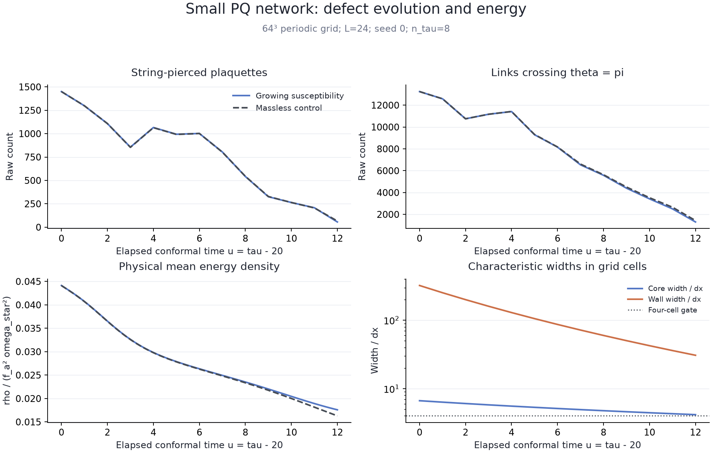
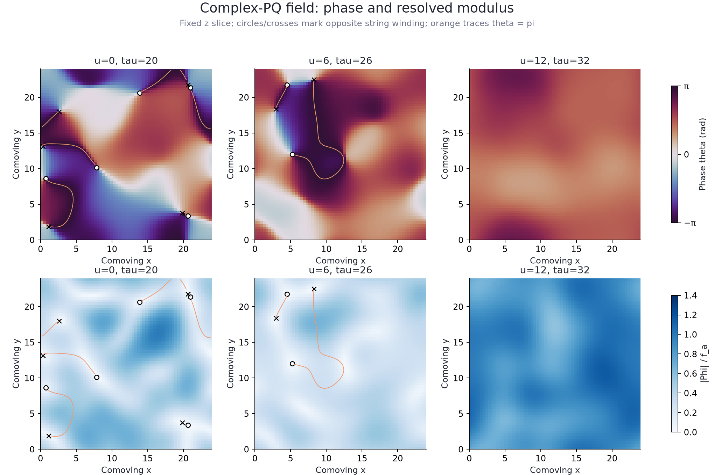
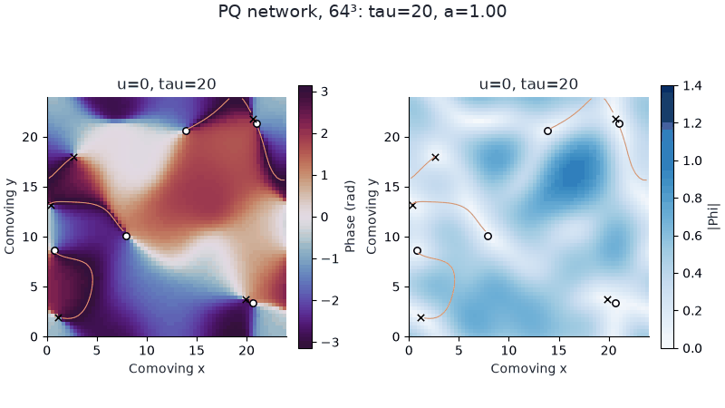

# First compiled complex-PQ simulations

A separate two-real-field CosmoLattice model now evolves the potential of
arXiv:2609.20801v1, Eq. (3), including the radial field and a growing QCD tilt.
Both deterministic annihilation and seeded network evolution have been run on
32³ and 64³ grids. All predeclared numerical checks pass. These are reduced
finite-box demonstrations, not a reproduction of the paper's scaling network
or its axion abundance/mass prediction.

## Recorded physical setup

The main network has N=64, L=24, dx=0.375, f_a=omega_star=1,
lambda=0.08 (m_s=0.4), initial tau=20, final tau=32, a=tau/20,
tau_star=27 and n_tau=8. Susceptibility is
chi=[20/27²]²*(tau/27)^8, enforcing m_a=H at tau=27.
PV2 uses conformal dt=0.02, with a repeat at dt=0.01. The periodic
nearest-neighbor Laplacian and the actual pinned CosmoLattice/TempLat kernels
provide the field evolution. A force-stage hook evaluates chi at each kick.

Seed 0 Gaussian complex initial data use Fourier filter exp(-k² ell²/4),
ell=2.5, and are normalized to <|Phi|²>=1 before cooling. Momentum is zero.
Static chi=0 gradient-flow cooling runs for fictitious time 2, dt=0.02,
with an implicit lattice Laplacian and explicit quartic force. The resulting
exact initial state is shared by growing-mass and massless controls. Physical
lambda is constant throughout production evolution. Cooling is saved separately.

This simpler preparation omits the paper's core-growth stage and does not
establish a scaling network. The initial correlation scale, short time interval,
volume, coupling and equality time are reduced demonstration parameters.
The final tau/tau_star is only 1.185; the paper's late wall-driven collapse
near tau/tau_star~3 is outside this run. Boundary conditions are explicitly
periodic; the box lacks the paper's separation of horizon and defect scales.

## What the simulations show

The growing-susceptibility network loses string-pierced plaquettes from
1450 to **56**, while the identical massless control ends at **66**.
This is about 96% reduction in a lattice intersection count, not a count of
individual strings. The massless network also decays substantially, so the
loss cannot be attributed entirely to domain walls. The theta=pi link count
and physical energy differ increasingly between the runs as chi grows.
These are observations of one realization, with no ensemble significance claim.

The symmetric analytic four-string configuration retains its neutral winding
and serves as a symmetric topology control. A +0.5 offset of its real component
makes opposite-string separations unequal; both N=32 and N=64 versions
annihilate all their initial plaquette winding by tau=26. Its massless control
also annihilates, providing a check of dynamical string attraction and topology
without attributing the result solely to wall forces.

The N=32, L=12 random pilot likewise loses all its initial winding in this
short interval. It illustrates finite-box relaxation, not a cosmological
network-collapse time. L=12 and L=24 results use different realizations in
physical space and are not an ensemble/box-size convergence comparison.

## Numerical evidence

- 37 checks in the independent validation suite pass: potential gradients,
  origin limit, vacuum masses, known winding, homogeneous and inhomogeneous
  evolution, time and state transfer, energies, refinement and invalid inputs.
- DOP853 independently integrates the same small-grid semi-discrete equations.
  At dt=0.0025 the expanding test's maximum final component/momentum error is
  1.40e-5; halving dt reduces error by 4.0002. The negative-phase static test
  independently exercises both Cartesian force components away from the origin.
- The main N=64 network's final field RMS change when halving dt is 5.17e-6.
  Its raw winding counts agree at every saved time in the two timestep runs.
- Matched N=32/N=64 random-network initial data use coarse cell averages of
  a frozen cooled N=64 state, holding L=12 and physical parameters fixed.
  Final coarse-versus-block-averaged-fine field RMS difference is 6.77e-4.
- The unequal-spacing deterministic case gives spatial RMS difference 4.68e-4.
  These finite checks do not establish asymptotic continuum convergence.
- Main-run characteristic core width decreases from 6.67 to **4.17 cells**;
  wall width remains above **30 cells**. Maximum m_a/m_s is below 0.16.
  Resolution and frequency guards are recorded; near-core dynamical resolution
  still needs further spatial studies before quantitative defect predictions.
- The energy equation includes Hubble dilution and explicit chi' work.
  Main-run relative integrated-balance residual is 1.64e-5, below the 0.003 gate.
  Independently reconstructed snapshot energies agree within 1e-12 absolute.
- All 30 repository tests pass with both compiled integration suites enabled.
  The existing one-scalar FOPT model and its outputs remain independent.

The original dt=0.01 expanding validator exceeded its 2e-4 error gate
(2.248e-4). That failure is retained under validation-02; the accepted
validation uses dt=0.005 and 0.0025 with the same error tolerance. No tolerance
was relaxed to obtain acceptance. The failed first report-writing attempt is
also retained in validation-01.

## Read the diagnostics correctly

Winding is the sum of wrapped phase increments around periodic plaquettes.
Exact-zero vertices have undefined phase and are rejected by this diagnostic;
the evolution force itself remains finite at zero. The plotted markers refer
to intersections with one fixed z slice, not every string in the 3D box.

Orange contours and wall-link counts locate the theta=pi branch surface.
For chi=0 this is a geometric phase surface, not a physical domain wall.
The paper's 2/3 orientation-corrected length/area formulas are retained as
exploratory isotropic estimators; raw counts are also saved and should be used
for the axis-aligned deterministic checks. No particle spectrum, emitted axion
number or relic abundance is inferred from these figures.

## Reproduce and inspect

[Build/run instructions](../README.md) · [model](../pq_model.h) ·
[driver](../evolve.cpp) · [independent reference](../model.py) ·
[validation](validation.json) · [summary](summary.json) · [provenance](provenance.json).

Raw initial fields, synchronized snapshots, histories, parameter files, run
logs and source copies live under outputs/pq_strings/{pilot-final,
refinement-final,matched-final,collapse-final,network-final,validation-complete}/.
The main run's frame cadence is du=1, with 13 frames. The animation uses a
fixed color normalization and fixed z plane throughout. Earlier exploratory
runs and failed validation are preserved in their own directories.

For a new run, use fresh output names and the commands in the parent README.
The timing fields include Python I/O and diagnostic processing; they are not
isolated native solver benchmarks. No acceleration claim is made here.

## Subsequent yield work

The [estimator and feasibility audit](yield/README.md) adds current spectra,
independent wave validation, necessary scale bounds, and validated core-growth
preparation. The user-selected [capped-mass toy](toy/README.md) follows that
audit with explicitly modified susceptibility, resolved wall-driven collapse,
late yield/energy measurements, temporal and spatial refinement, and seed
variation. These later phases retain the earlier raw runs and their conclusions.
