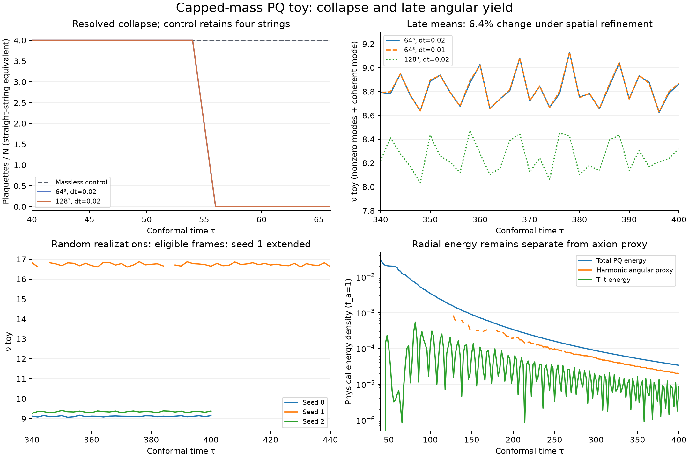

# Capped-mass finite-box PQ toy

This is the explicitly modified model selected after the fixed-grid feasibility
[audit](../yield/README.md). It studies resolved wall-driven collapse and late
angular yield in a periodic box. It does not reproduce the paper's cosmological
network, scaling extrapolation, physical axion mass or relic abundance.

## Setup and controls

The full two-real-field PQ potential and radiation background remain active.
Use f_a=1, L=24, lambda=0.08 (m_s=0.4), a=tau/40, and canonical momenta
pi=a²*F'. Preparation matches lambda=lambda_physical*(44/tau)^4 continuously
onto physical constant lambda at tau=44. Before evolution, static chi=0
implicit-Laplacian diffusion runs for fictitious time 2, step 0.01.

The modified susceptibility is chi=0.06²*S(clip((tau-44)/6,0,1)), where
S(s)=10s³-15s⁴+6s⁵. It reaches a constant physical angular mass 0.06 at tau=50,
keeping m_a/m_s<=0.15. This replaces the paper's indefinitely growing mass law.
Force-stage coefficients and the explicit chi' energy source are validated
against the independent semi-discrete DOP853 reference, including unaligned
transition times. Halving dt reduces the state error by a factor 4.0002.

The controlled initial state contains four symmetric, neutral, straight strings.
N=64 uses dx=0.375 and dt=0.02. The massless control and dt=0.01 repeat use the
exact same frozen input. N=128, dx=0.1875, dt=0.02 Fourier-interpolates that
N=64 frozen state with all physical parameters fixed. Both fields and momenta
are transferred, with no reseeding. All evolution uses the compiled pinned
CosmoLattice/TempLat PV2 backend.

The random realizations use Gaussian filter exp(-k²*2.5²/4), unit initial
<|Phi|²>, zero momenta, NumPy PCG64 seeds 0, 1, 2, and the same cooling and
mass schedule. Their finite-volume scatter is descriptive; only the controlled
case has matched temporal and spatial refinement here.

## Observables and acceptance

Wrapped periodic plaquette windings measure string intersections. For the
straight configuration, plaquettes/N gives the equivalent number of strings;
isotropic 2/3 length calibration is not applied to these aligned strings.
Branch-cut links locate theta=pi. The massless branch surface is a diagnostic,
not a physical wall.

The axion estimator uses modulus-weighted temporal and midpoint-link spatial
currents with longitudinal lattice-momentum projection. The companion fully
lattice dispersion defines the primary toy number sum; the continuum version
is saved as a cross-check. Exact zero projections are rejected without epsilon.
The current estimator excludes k=0. A separate harmonic completion uses
rho_0=<J0>²/(2a²)+m_a²*<theta>²/2 and n_0=rho_0/m_a, only when defects are
absent, max|theta|<=0.3, and radial RMS displacement<=0.1.

Report nu_toy=(a/a_star)³*n_a/H_star, with tau_star solving m_a=H during this
modified turn-on, H_star=40/tau_star². This normalization alone does not equate
the toy with the paper. The coherent zero mode can dominate a small random box.

The predeclared gates require four cells per core while defects remain, four
per characteristic wall width, two harmonic mass periods, <=5% peak-to-peak
late yield variation, <=1% temporal change and <=10% spatial change. Failed
gates remain failed. The controlled late window is tau=340–400. Seed 1 alone
is extended with unchanged physics to tau=440 to obtain two small-angle mass
periods; its eligible late window starts at tau=388. Initial transients and
ineligible frames are never silently given a completed yield.

The reported physical energy includes kinetic, gradients, radial potential
and tilt. The harmonic angular energy proxy is separate from total PQ energy;
remaining radial waves are not counted as axions. Cores eventually shrink below
four cells after all defects disappear. Later smooth-wave estimates therefore
also need the independent spatial comparison; late core-width values are saved,
not hidden. Evolution beyond a box crossing is intentionally a finite-box study.

## Evidence files

`comparison.json` is the authoritative combined result. It preserves all gates,
late means, peak-to-peak variation, refinement differences, seed statistics,
raw source paths, initial-state checksums and solver checksums. `base_*`, `time_*`,
`space_*` and `seed*_*` contain compact contracts, provenance, full topology,
current/energy histories and analyses. The N=128 FFT analysis evaluates the same
fixed late window; its full topology history is still retained.

Raw native states remain under `outputs/pq_strings/toy-*`; no prior runs are
replaced. `run_toy.py`, `analyze_toy.py`, `compare_toy.py` and `plot_toy.py` provide
the rerunnable workflow. All 42 repository tests pass, including the actual
compiled capped-mass reference and the coherent-mode normalization test.

## Measured result

All four controlled strings disappear between tau=54 and 56 on both grids.
The last defect frame has 4.94 core cells on N=64 and 9.88 on N=128. The
matched massless control retains four strings at the resolved comparison time.

| Controlled run | Late mean nu_toy | Peak-to-peak variation |
| --- | ---: | ---: |
| 64³, dt=0.02 | 8.8212 | 5.72% |
| 64³, dt=0.01 | 8.8243 | 5.65% |
| 128³, dt=0.02 | 8.2551 | 5.30% |

The timestep change is **0.036%** and the spatial change is **6.42%**. Both
refinement gates pass. The controlled plateau gate **fails** on all three runs:
its threshold was 5%, not adjusted after inspecting the results. The two-half
late-window mean changes are only 0.14–0.23%, suggesting remaining oscillations
rather than rapid secular drift, but this descriptive statistic does not
replace the failed peak-to-peak gate. The measured toy yield is of order ten;
it is not certified as the final asymptotic plateau.

The three random late means are **9.1167, 16.7371, 9.3448**. Their mean is
11.7329 and sample standard deviation 4.3353 (three realizations only). Their
peak-to-peak variations are 1.12%, 1.53%, and 1.58%, and all have at least two
small-angle mass periods after the seed-1 extension. At its final time the
coherent zero mode supplies about 72% of seed 1's estimated number, illustrating
the strong finite-box dependence. These seeds do not have their own spatial
refinement repeats, so the scatter is not a calibrated continuum uncertainty.

At tau=400 the 64³ controlled run has total PQ energy density **3.3881e-5**
and harmonic angular energy proxy **2.0029e-5**, in the stated f_a=1 units.
The matched 128³ values are **3.6084e-5** and **1.9026e-5**. The discrepancy
between PQ total and angular energy is why total energy is not called axion
energy density. No conversion to today's physical relic density is justified.

The concrete next numerical improvement is to determine whether the residual
oscillations come from physical radial–angular exchange or lattice error, using
a phase-averaged diagnostic and a radial-radiation control with new predeclared
gates. Increasing statistical or cosmological claims is not warranted by this
finite-box experiment.
