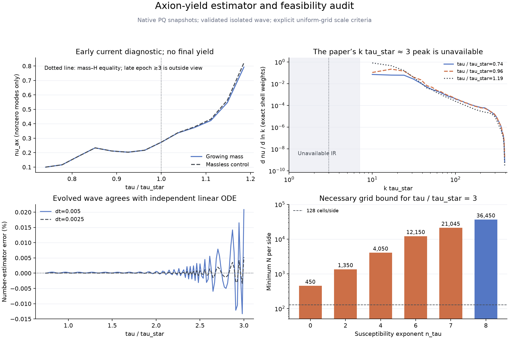
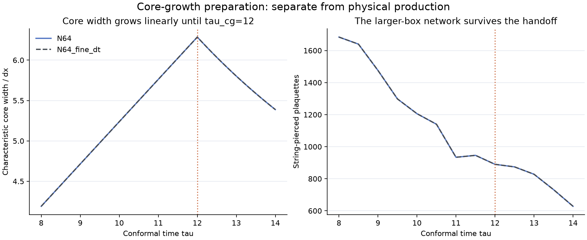

# Current estimator, scale audit and preparation

The current-based estimator and preparation checks are implemented and validated.
They show why the original small grids cannot reach the paper's late result while
retaining the stated scale criteria. The subsequent user-selected modification
is documented separately in [the capped-mass toy](../toy/README.md).

## Numerical evidence

- Angular currents use `Im(conj(Phi/|Phi|)*dPhi)`, with Cartesian time derivatives
  and midpoint forward links. Link FFT phases are aligned before projection onto
  `K_i=2 sin(k_i dx/2)/dx`. Radial projections remain separate.
- Full normalized FFT sums count each conjugate mode once. Shell integrations
  reproduce the finite-mode number sum. The coherent zero mode is excluded from
  this current-only estimator; its temporal kinetic diagnostic is not a full
  zero-mode number estimate.
- Analytic oblique waves check phase, modulus weighting, longitudinal/transverse
  separation, Parseval identities and coordinate normalization. An actually evolved
  tiny-amplitude wave agrees with the independent semi-discrete linear ODE. Its
  timestep yield difference is 0.0156%; it is a normalization check, not an abundance.
- Existing N=64, L=24 short-network diagnostics end at tau/tau_star=1.185, with
  56 string-pierced plaquettes and nu_current≈0.792. The matching massless control
  gives ≈0.821. Neither run is qualified as a late yield.

## Necessary fixed-grid bound

With susceptibility proportional to tau^8, collapse epoch tau/tau_star=3,
L/tau_star>=6, at least four cells per core and m_a/m_s<=0.16, the necessary
bound is N>=36,450. Even relaxed one-cell cores and m_a/m_s<=0.2 require N>=7,290.
These are bounds for the stated physical fixed-grid criteria, not minimum grids
for every possible numerical method. The 64³/128³ grids do not meet them.
The IR peak of the paper is also outside the original small box's sampled modes.
The feasibility JSON records assumptions and alternative mass-law exponents.

## Core-growth preparation

Preparation uses lambda=lambda_physical*(tau_cg/tau)^4 until tau_cg, then constant
physical lambda. The field force and lambda energy source are staged consistently.
Independent inhomogeneous DOP853 checks pass, including a handoff within the
first kick. Temporal error decreases by approximately four on halving dt.

The L=12 matched-grid preparation loses its network by the handoff. The L=24,
N=64 preparation keeps 890 pierced plaquettes at tau=12 and 628 at tau=14;
cores remain at least 4.19 cells wide. The timestep field RMS difference is
5.52e-7. This verifies a preparation implementation and survival, without
establishing scaling, a late abundance, or large-volume convergence.

Raw evidence remains in `outputs/pq_strings/yield-audit-final`,
`feasibility-01`, `yield-wave-validation-01`, `preparation-validation-02`, and
`preparation-volume-01`. The compact contracts, validations and plots here
are copies; raw states and initial conditions are retained in those run folders.
`tests.log` records all 42 tests passing after the capped-mass addition.

Source equations: [main paper](https://arxiv.org/abs/2609.20801),
[current projection](https://arxiv.org/abs/2512.13653),
[preparation reference](https://arxiv.org/abs/2410.18064).
Our midpoint discretization and reduced schedules are explicit implementation
choices, rather than a claim of matching HILA bit for bit.
