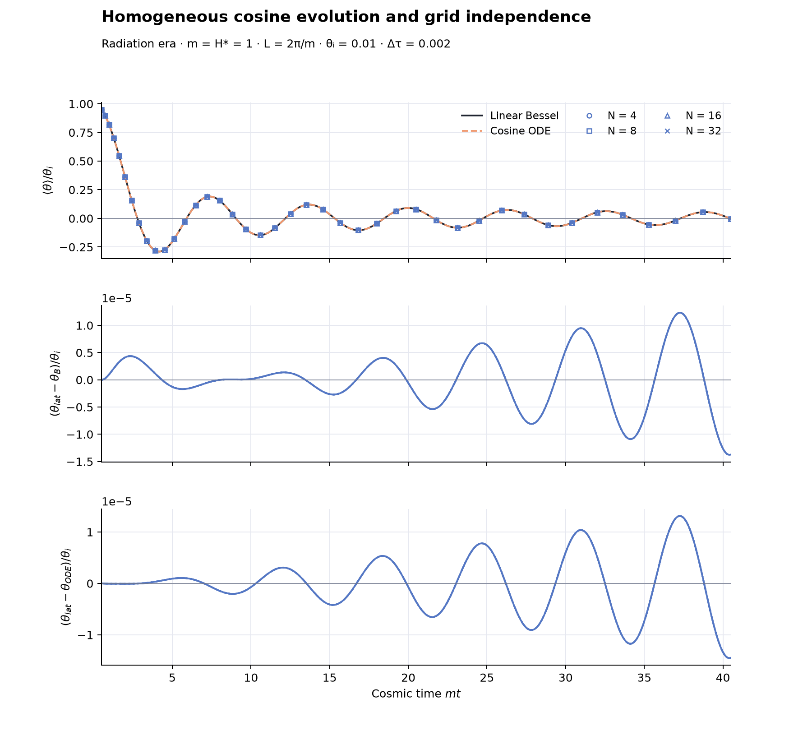
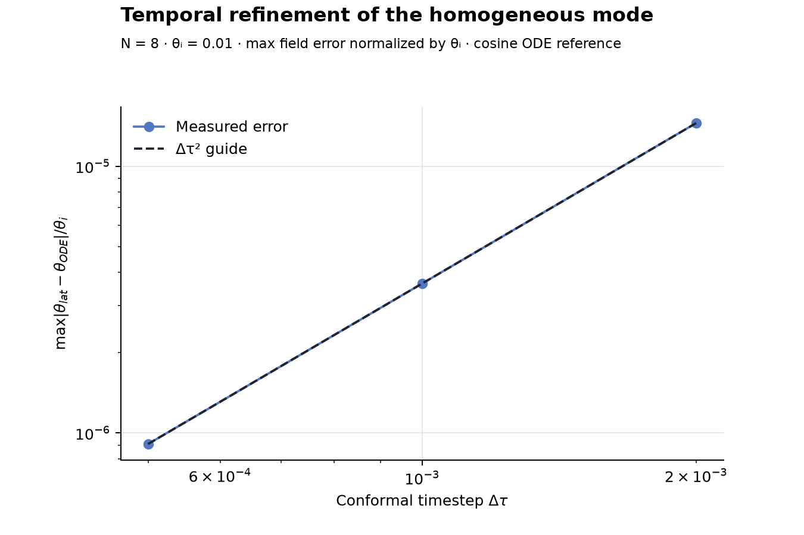

# Homogeneous radiation-era results — 2026-10-13

All 59 measured acceptance gates passed in seven actual CosmoLattice runs.
This is a controlled homogeneous check with the cosine potential; no bubble
or non-expanding run has been performed.

Run command, from repository root:

```sh
PYTHONPATH=src MPLCONFIGDIR=/tmp/afopt-mpl python3 checks/homogeneous.py --output outputs/homogeneous-checks
```

The actual compiled executable was checked with an incremental CMake build.
Build identity, executable/source SHA256 hashes, Python/library versions,
working-tree status, all measured tolerances and outcomes are in
[summary.json](summary.json). Full histories, per-run reference curves,
inputs, logs, and initial/final cell snapshots are under the ignored
`outputs/homogeneous-checks/` directory. Use a new output path for a repeat.

## Analytic and nonlinear comparisons

Radiation domination, constant m=H_*=1, a=tau=1+u, t=tau^2/2,
L=2*pi/m, t_initial=0.5, t_final=40.5. The finite-start field and
velocity match the regular early-time Bessel branch in
[Appendix B, Eq. B2](https://arxiv.org/pdf/2607.01333).
theta_i below is that branch's extrapolated early-time amplitude.

All table errors are max absolute field differences over the entire saved
history, divided by theta_i. They are not pointwise relative errors at zero
crossings. Cosine ODE means an independent DOP853 solution of the full nonlinear
equation. Bessel means the analytic linearized equation.

| Ngrid | Conformal dt | theta_i | Lattice vs cosine ODE | Lattice vs Bessel |
|---|---|---|---|---|
| 4 | 0.002 | 0.01 | 1.453198e-05 | 1.377608e-05 |
| 8 | 0.002 | 0.01 | 1.453198e-05 | 1.377608e-05 |
| 16 | 0.002 | 0.01 | 1.453198e-05 | 1.377608e-05 |
| 32 | 0.002 | 0.01 | 1.453198e-05 | 1.377608e-05 |
| 8 | 0.001 | 0.01 | 3.632969e-06 | 4.401463e-06 |
| 8 | 0.0005 | 0.01 | 9.082434e-07 | 4.414049e-06 |
| 8 | 0.0005 | 0.001 | 9.082417e-07 | 9.006798e-07 |



All four grids overlap in the curve and residual panels. Grid-to-grid maximum
field-history difference is **7.697e-13 theta_i**; the canonical
momentum-history difference is **2.784e-11 theta_i**. Initial and final
local field and momentum peak-to-peak spreads are exactly zero in every run.
Moment-based variance checks through the evolution are within roundoff.
Homogeneity removes the Laplacian, so grid independence here does not test
spatial accuracy for a bubble or other nonuniform field.

## Time refinement and the small-angle limit

At Ngrid=8 and theta_i=0.01, reducing dt from 0.002 to 0.0005 reduces
field error against the cosine ODE by **16.00009**,
as expected for second-order temporal convergence. The finest normalized
field error is **9.082e-07**.



The independent cosine-minus-Bessel field difference is
4.418245e-06 theta_i at theta_i=0.01 and
4.418232e-08 theta_i at theta_i=0.001:
a ratio of **100.00029**. This is consistent with a normalized
nonlinear correction proportional to theta_i^2. A Bessel mismatch therefore
need not be an integrator error; cosine-ODE residuals isolate numerical error.

Canonical momentum is pi=a^2*dtheta/du. Its absolute amplitude grows with a,
so the `pi_error_cosine` values normalized by theta_i in summary.json should
not be interpreted as fractional momentum errors. For completeness they are
9.572779e-03, 2.393185e-03, and
5.982950e-04 for dt=0.002,0.001,0.0005 respectively,
also decreasing by approximately four per timestep halving. Momentum numerical
errors are recorded diagnostically; the predeclared temporal gate uses field errors.

These checks support analytic agreement, temporal convergence and grid
independence of this homogeneous mode over the chosen time interval. They do
not reproduce a paper abundance result or establish inhomogeneous convergence.
The future centered-bubble and optional non-expanding cases remain in
[the workspace plan](../README.md).
