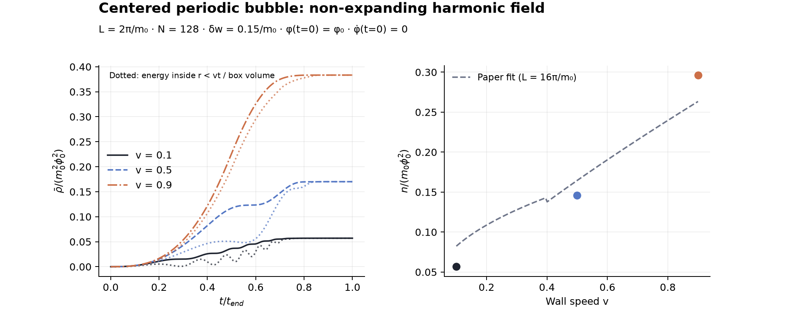
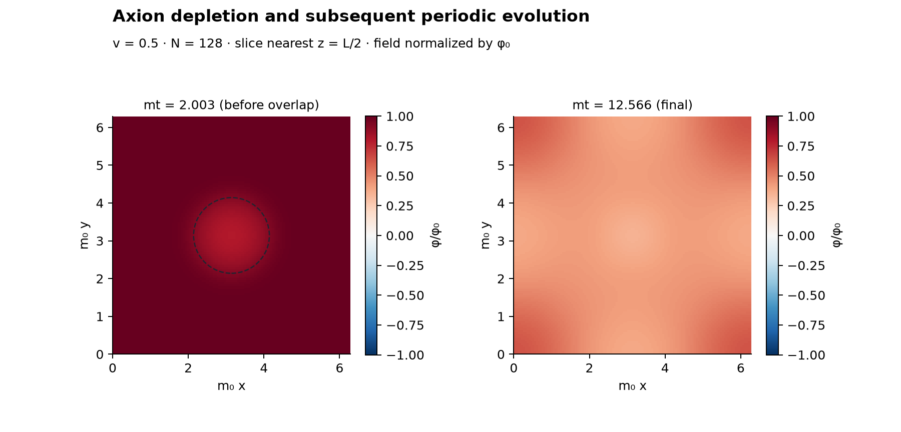

# Matched smallest-box setup — 2026-10-13

Seven actual CosmoLattice runs completed; all 24 numerical gates
passed. The new independent PDE, energy-work and Fourier normalization tests
also pass, together with the previous checks (17 tests total).

We implemented the non-expanding, harmonic, smooth-wall setup of
[Lee et al. (2024), Sec. IV F](https://arxiv.org/pdf/2402.09501).
The three N=128 runs match the smallest Table-I box (L=2*pi/m0), wall width
0.15/m0, initial uniform field and zero velocity, and endpoint t=L/v.
This establishes a matched numerical setup and tested observables; it is not
an assertion that the entire published parameter scan has been reproduced.

## Final observables

m0=phi0=1. Number columns are n/(m0*phi0^2); energy is rho/(m0^2*phi0^2).
Continuum frequency is the paper's definition. Stencil frequency uses the
nearest-neighbor lattice dispersion as a discretization diagnostic.

| v | m0 t_end | n, continuum | n, stencil | Final energy | Paper approximate fit | Difference from fit |
|---|---|---|---|---|---|---|
| 0.1 | 62.831853 | 0.05664170 | 0.05664167 | 0.05705908 | 0.08236894 | -31.23% |
| 0.5 | 12.566371 | 0.14577622 | 0.14577707 | 0.17011320 | 0.16453892 | -11.40% |
| 0.9 | 6.981317 | 0.29636876 | 0.29636664 | 0.38338580 | 0.26332170 | +12.55% |

The fit of Eqs. (56)-(57) was obtained at L=16*pi/m0. Its extension to our
smaller box gives the differences above; notably **the slow-wall result is
31.2% below this fit**. The fit is an approximate larger-box relation, and
the paper describes box-size scaling as approximate. We have no raw numerical
reference or digitized point for a same-box, same-grid quantitative comparison.
Therefore this deviation remains a comparison to investigate, not a discrepancy
we can attribute to a particular cause or claim resolved by these checks.

Dotted energy curves are the inside-bubble energy divided by the whole box
volume. The solid/dashed curves use different styles for each velocity. Axion
number is calculated only after conversion; it is not assumed conserved while
the mass changes. The nonzero initial smooth-profile tail is included.

## Resolution and timestep checks at v=0.5

| Ngrid | dt | n/(m0 phi0^2) | Run time, seconds |
|---|---|---|---|
| 32 | 0.00981748 | 0.14568121 | 1.0 |
| 64 | 0.00981748 | 0.14575727 | 6.4 |
| 64 | 0.00490874 | 0.14575759 | 10.4 |
| 128 | 0.00981748 | 0.14577622 | 44.4 |
| 128 | 0.00490874 | 0.14577654 | 66.7 |

With fixed dt, changing N=64 to 128 changes the final continuum number by
**0.01300%**. Halving dt at N=128 changes it by
**0.000223%**. The wall-width parameter spans 3.06 cells at N=128.
These refinements support stability of this integrated observable at v=0.5;
no spatial-continuum claim is made for each local field feature or for the
other velocities, which have not been independently refined in this run.

At N=8, an independently integrated DOP853 periodic PDE agrees with the
adapter's local field and momentum, with second-order temporal refinement.
This tests force timing, the quadratic force, smooth mass transfer and the
Laplacian at fixed grid resolution, rather than using the solver itself as
its reference.

## Energy accounting and field evolution

All runs satisfy the finite-grid energy/work balance. The largest relative
residual is **1.551e-05**, including temporal sampling error in the source
integral. The full-FFT stencil energy agrees with the real-space energy by
Parseval's theorem to roundoff. The zero mode is retained in the total number
and reported separately in summary.json; it is excluded from logarithmic
spectral bins.

At mt=2.002765 in the v=0.5 run, before periodic waves overlap, the mean field
inside r<vt is 0.87109*phi0, versus 0.99833*phi0 outside. The dashed circle
marks the wall's intersection with the saved plane. Depletion is modest at
this early time; this small-box checkpoint is not the long-time radial
solution plotted in the paper's Fig. 6. The right panel is the field after
the mass has become uniform, including the effect of periodic propagation.

## Reproducibility and limits

Command: `PYTHONPATH=src MPLCONFIGDIR=/tmp/afopt-mpl python3 checks/single_bubble/run.py --output outputs/lee-single-bubble`.

[summary.json](summary.json) stores exact numerical gates, measured errors,
executable/source hashes, versions, and build identity. Source hashes describe
the working-tree files when the summary was generated. Per-run histories and
shell spectra are retained alongside this document. Exact input JSONs, full
binary states and logs are under ignored outputs/lee-single-bubble/.

The existing cosine/sharp-wall defaults remain available. The adapter is
CPU/Serial PV2 with a nearest-neighbor stencil and cell-centered sampling;
the paper's full discretization implementation was not supplied. We have not
run the L=4*pi,8*pi,16*pi rows, checked the full inverse-L scaling, or matched
the large-box energy history and spectra in Figs. 7 and 10. Resolving the
larger-box comparison requires a scale-up and a quantitative figure/raw-data
reference, rather than extrapolating this homogeneous or small-box validation.
