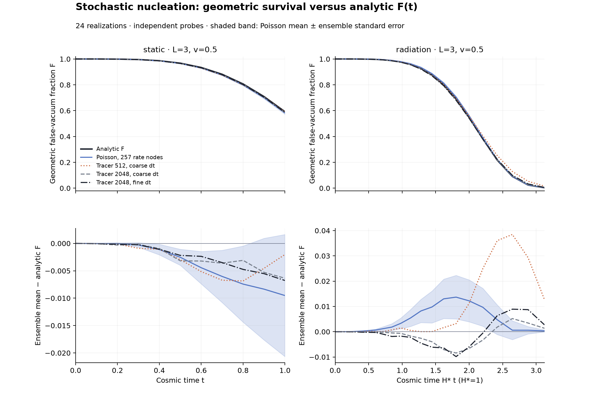
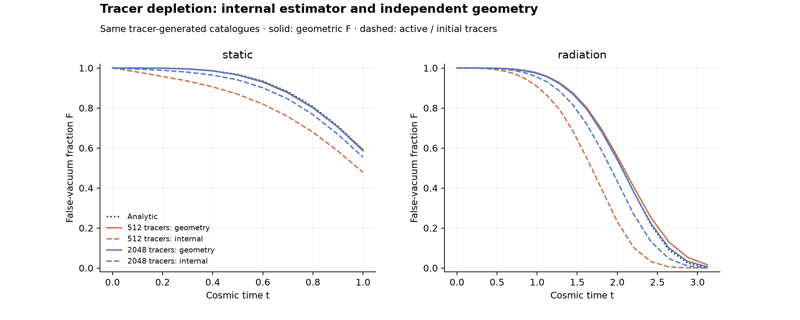

# Initial analytic F(t) comparison — 2026-10-13

The independent Poisson sampler passes the predeclared survival checks in a
static control and a radiation-era diagnostic. All 739 recorded gates pass,
including geometric bounds/monotonicity, probe-half comparisons, rate-interpolant
accuracy, identical-event phantom equivalence and causal accepted births.
The complete repository test suite also passes (20 tests, with the existing
CosmoLattice adapter enabled).

The primary observable is the geometric fraction of the box still in false
vacuum, measured with independent probe points. Its expectation is compared
with the common-speed survival reference corresponding to
[Eq. (3) of the paper](https://arxiv.org/pdf/2607.01333):

    F(tau) = exp[-(4*pi/3) v^3 integral_0^tau q(s)(tau-s)^3 ds],
    q = Gamma a^4.

This expression includes overlap through the exponential; it is not a sum of
accepted-bubble volumes. Cosmic and conformal integrations agree to 2.55e-14
or better. Initial cosmic time is zero in the physical radiation background;
we do not extrapolate radiation domination to negative cosmic times or suppress
all births before t*. Each bubble's largest possible radius stays below L/2,
so the Euclidean volume reference is appropriate despite periodic boundaries.

## Configuration and uncertainty

See [EXPERIMENT.md](../EXPERIMENT.md) for parameters and acceptance thresholds
written before the ensembles were executed. Both cases use L=3 and v=0.5.
The static control has q=4 and tau_end=1. Radiation has H*=beta=1,
a=tau, t=tau^2/2 and tau_end=2.5 (t_end=3.125). This slow-rate case is not
an attempted reproduction of the full Fig. 1 parameter scan.

Each engine/configuration uses 24 independent catalogue realizations (seeds
0..23) and 2048 independently generated probe positions per realization.
Methods share probe positions for a given seed, but their event streams are
not matched. The ensemble standard error measures uncertainty in the mean;
the realization spread is stored separately. The two probe halves provide a
separate sampling-resolution diagnostic. No independent-cell binomial error
model is applied to lattice cells.

## Endpoint values

Errors after ± are ensemble standard errors, not realization standard deviations.
Internal tracer F is active/initial tracers; it is not the same observable as
independently probed converted geometry.

| Case | Engine | Analytic F_end | Geometric mean F_end ± SE | Internal tracer mean F_end |
|---|---|---|---|---|
| static | poisson_65 | 0.592385 | 0.587850 ± 0.010209 | — |
| static | poisson_257 | 0.592385 | 0.582865 ± 0.011147 | — |
| static | tracer_512_coarse | 0.592385 | 0.590352 ± 0.008609 | 0.478434 |
| static | tracer_2048_coarse | 0.592385 | 0.586019 ± 0.008486 | 0.554443 |
| static | tracer_2048_fine | 0.592385 | 0.585612 ± 0.010163 | 0.554159 |
| radiation | poisson_65 | 0.003176 | 0.002523 ± 0.000356 | — |
| radiation | poisson_257 | 0.003176 | 0.003499 ± 0.000387 | — |
| radiation | tracer_512_coarse | 0.003176 | 0.015849 ± 0.001340 | 0.000000 |
| radiation | tracer_2048_coarse | 0.003176 | 0.004537 ± 0.000439 | 0.000793 |
| radiation | tracer_2048_fine | 0.003176 | 0.005900 ± 0.000610 | 0.001119 |



The geometric Poisson curves pass the pointwise criterion
abs(mean_F - interpolant_F) <= 4*ensemble_SE + 0.005 at every saved time.
For the fine radiation rate grid, replacing the physical rate by its linear
interpolant changes analytic F by at most 5.983e-5. The remaining measured
residual is dominated by this small ensemble's statistical uncertainty; a
larger ensemble is needed for a tighter precision claim. Refining rate grids
changes RNG consumption, so catalogue-by-catalogue equality is not expected.

## Tracer depletion and estimator distinction



In the radiation case, every 512-tracer run reaches zero active tracers at the
endpoint, yet the independent geometric mean is 0.01585 ± 0.00134. The analytic
prediction is 0.003176. Thus internal F=0 does not by itself prove geometric
completion. With 2048 tracers the difference between internal and geometric
estimators decreases, but it remains visible.

The tracer curve is biased by nucleation-site removal as well as engulfment:
tracers are both a finite source population and an estimator. Discrete-step
birth placement and end-of-outer-step engulfment are additional discretizations.
These measurements do not isolate every contribution or establish tracer
convergence. In particular, halving the timestep does not monotonically improve
all observed errors with this small ensemble. The paper used 100,000 tracers;
this diagnostic deliberately uses much smaller populations and does not establish
an error in the paper's parameter runs.

## Implementation and preservation

`sample_candidates` exposes the attempted Poisson catalogue and
`exclude_converted_births` applies the existing brute-force exclusion.
`sample_catalogue` composes these operations with the same RNG call order.
Pre/post-refactor catalogue hashes were identical for seeds 0 and 42 in the
static fixture. All-candidate and accepted arrival maps agree exactly on the
ensemble probes, and no accepted Poisson birth lies inside an earlier front.

The tracer reference verifies the original file against GitHub commit 1b67fec
and blob ace7473 before loading only the bubble/tracer classes and geometry
kernels. JIT disk caching is disabled; the original checkout is unchanged.
The driver imposes fixed outer timesteps instead of running field evolution
and its CFL controller. Consequently this is a geometry-only adaptation of the
frozen source, not a bit-for-bit rerun of the coupled paper simulation. The
later experimental Poisson engine from miniclusters was not used.

## Reproduce and inspect

```sh
PYTHONPATH=src MPLCONFIGDIR=/tmp/afopt-mpl python3 checks/stochastic/run_survival.py \
  --output outputs/stochastic/survival-new
```

Requires NumPy, SciPy, Numba and Matplotlib, plus the pinned source file available
through `--paper-source` or its default local checkout path. Use a fresh output
directory. The original source snapshot, per-seed catalogues and curves remain
under ignored outputs/stochastic/survival-reference/. CSV summaries and exact
rate tables are retained here with [summary.json](summary.json), source hashes,
seed lists and all measured gates. The earlier survival-first run is retained
as preliminary output; the recorded comparison above uses survival-reference,
after matching the paper's zero-rate RNG handling.

Next comparisons should increase tracer populations and catalogue ensembles,
then examine the paper's faster beta/H* cases while keeping box-volume effects,
rate resolution and timestep dependence separate. No coupled stochastic axion
field run has been performed in this experiment.
