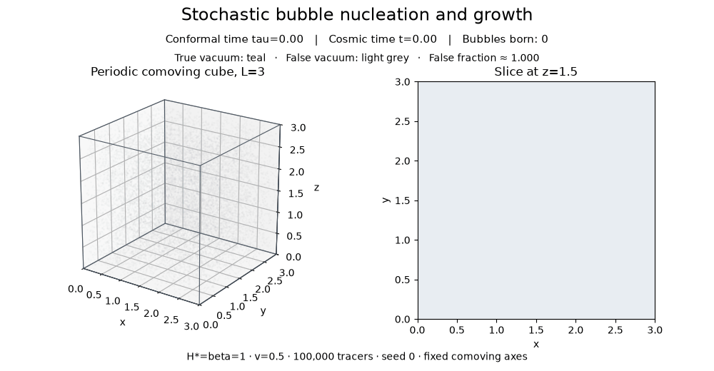
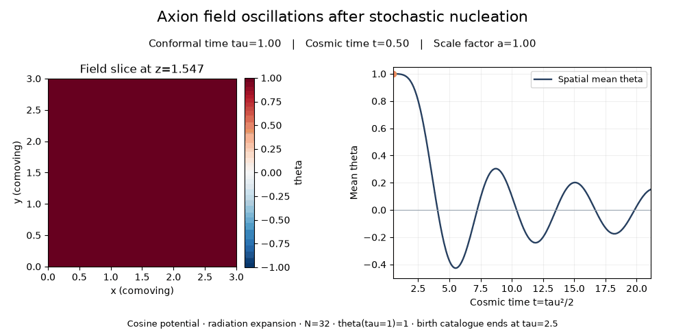

# Representative animations

[Bubble nucleation GIF](bubble_nucleation.gif): 55 frames, conformal tau=0..2.7.
The cube shows 15000 independent probes colored by exact periodic first arrival;
the companion z=1.5 section uses 120x120 samples. Teal is true vacuum, grey
false vacuum. Probe visualization does not enter the nucleation calculation.
Axes are comoving, so the cube does not expand visually. Time labels include
both conformal tau and cosmic t=tau^2/2.

[Axion oscillation GIF](axion_oscillations.gif): 111 actual CosmoLattice frames,
tau=1..6.5, N=32, du=0.005. The slice at z=1.546875 has a fixed theta color
scale [-1,1], paired with the evolving spatial mean. Six mean zero crossings
show real field oscillation and radiation-era damping. No sine-wave animation
or interpolated field solution was substituted. Image interpolation is only
for rendering the N32 slice.

H=beta=mt=1,mf=0,L=3,v=0.5; cosine potential, comoving wall width 0.15;
100000 tracers, seed 0, 614-bubble catalogue from the validated field run.
Field starts uniformly theta=1,theta'=0 at tau=1. The frozen birth catalogue
ends at tau=2.5; existing bubbles keep growing during the field extension.
No additional nucleation or backreaction is modeled in this representative
extension. It is not a late-time abundance calculation.

Every field frame's scale factor and local mass were checked. The frame at
tau=2.5 reproduces the earlier validated N32 final state exactly. Numbered
native frames use the optional snapshot_every=10 cadence. All 24 repository
tests pass, including a test that frame output preserves field dynamics.

Inputs, binary frames, history and logs remain in
outputs/stochastic/representative-gifs/. summary.json records provenance.
The renderer is checks/stochastic/make_gifs.py; rerender using --output with
a fresh directory. The simulation uses input.json saved beside the frames.

