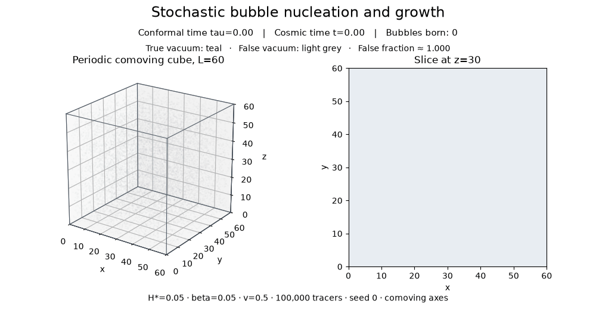
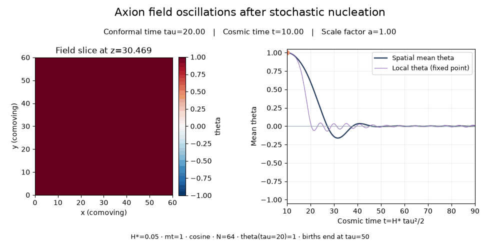

# Representative H*=0.05 animations

The preceding GIFs used H*=1. These use H*=0.05 while retaining mt=1,
mf=0, beta/H*=1, H*L=3, H*width=0.15 and v=0.5. Thus beta=0.05,
L=60 and comoving wall width=3. The H*/mt ratio is twenty times smaller.

The normalized bubble process is scale-covariant at fixed beta/H* and H*L.
Reuse the validated seed-0 614-bubble catalogue by scaling positions and
conformal births by 20. Its dimensionless geometry is therefore the same as
in the H*=1 GIF, with new physical coordinates/times. Analytic F agrees under
this rescaling within 1e-12. This rescaling does not reuse the axion field;
the cosine axion is independently evolved by the native solver.

Field N=64, PV2,du=0.01: start tau=20,t=10,a=1 with theta=1,theta'=0;
end tau=60,t=90,a=3. Frozen nucleation window tau=0..50. Existing bubbles
continue growing afterwards. Fixed comoving axes; no axion/bubble backreaction.
Bubble GIF: 55 frames; cube uses independent probes and a z=30 section.
Field GIF: 201 native frames, interval dtau=0.2, fixed theta colors [-1,1].
Field slice z=30.46875. The accompanying traces show the spatial mean and
one fixed site's actual theta: local oscillations can remain when spatial
phase cancellation suppresses the mean. The animation is uniform in conformal
rather than cosmic time. Absolute oscillation periods must be read from
physical time labels, not wall-clock playback speed.

Validation passed: all local mass/scale checks; N64 half-timestep difference
at tau=50 is RMS 1.89e-5 in theta. Independent N8 DOP853 final reference
errors are 1.74e-4 (theta) and 5.53e-3 (canonical pi). These are temporal
and transfer checks on the same semi-discrete equations.

Spatial accuracy is not certified. At tau=60, N32 versus block-averaged N64
field RMS difference is 0.07096, comparable to the N64 field's standard
deviation 0.06895. Lower H*/m creates additional fine phase structure;
these GIFs are representative N64 results, not spatially converged predictions
or a late-time abundance calculation. Further grid refinement is needed
before interpreting detailed small-scale patterns quantitatively.

Main 4000-step N64 run: 15.72 s including frame output. Refined 6000-step
run to tau=50: 20.33 s. Full native histories, binary frames, initial data,
source snapshots and parameter files remain under
outputs/stochastic/representative-H0.05/. Validation details are copied here.

Reproduce with checks/stochastic/run_low_h_gifs.py --output <fresh_directory>,
then checks/stochastic/make_gifs.py --source <that_directory> --output
<fresh_render_directory>. H*=1 GIFs and runs are preserved.

