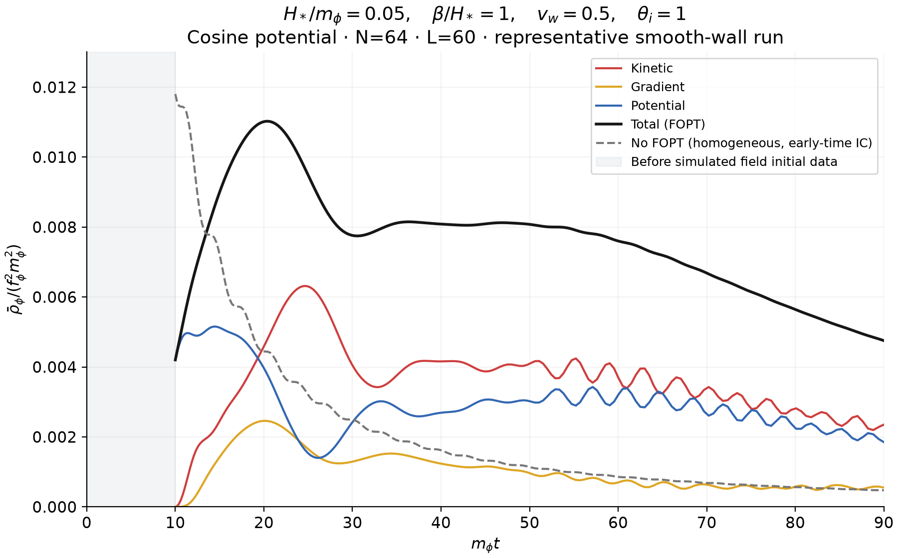
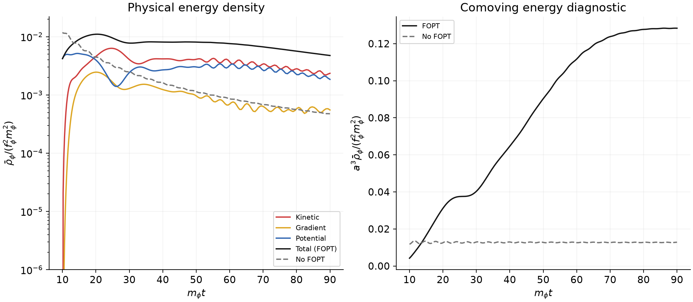

# Physical energy evolution for H*/m_phi=0.05

[Main plot](energy_evolution.png) uses m_phi*t (cosmic time) horizontally
and rho_bar/(f_phi^2*m_phi^2) vertically, following Eq.12 and Fig.2 of
[Axion Misalignment Across First-Order Phase Transitions](https://arxiv.org/pdf/2607.01333).
Kinetic is red, gradient yellow, potential blue, total black. The grey dashed
line is an independent homogeneous cosine no-FOPT solution with regular
initial theta_i=1 near cosmic time zero. It is not a mass-always-on field
reinitialized to theta=1 at t=10.

Use the actual 201 N64 native field snapshots from the H*=0.05 GIF run.
With theta=phi/f_phi and stored pi=a^2*dtheta/dtau (omega_star=1),
physical theta_dot=pi/a^3. Thus, in the present m_phi=f_phi=1 units,

    K = <pi^2>/(2 a^6)
    G = <sum_i [(theta(x+dx_i)-theta(x))/dx]^2>/(2 a^2)
    V = <m^2(x,t) (1-cos(theta))>
    rho_bar = K+G+V

The forward periodic gradient corresponds to the solver's nearest-neighbor
Laplacian; use the same stencil dispersion for its independent Fourier check.
Do not use pi^2/2 as physical kinetic energy in an expanding background.

This is a plot of the current representative run, not a reproduction of the
paper's Fig.2 parameters:

| Parameter | Current run | Paper Fig.2 |
|---|---|---|
| H*/m_phi | 0.05 | 0.05 |
| beta/H* | 1 | 4 |
| v_w | 0.5 | 0.15 |
| theta_i | 1 | 2 |
| L*m_phi | 60 | 8*pi |
| Ngrid | 64 | 128 |
| Wall | smooth first-arrival profile, comoving width*m_phi=3 | thin-wall step |

Current field initial data are imposed at tau=20, cosmic t=10. The shaded
interval t<10 has no simulated field data and is not artificially filled with
zero energy. At t=10 the smooth profile already gives nonzero potential energy
0.0042018 (including precursor tails from the fixed first-arrival profile).
This differs from a sharp-mass, fully-false-vacuum initial state. Birth catalogue
is frozen after tau=50; the field extends to tau=60,t=90. This finite-time start,
broad smooth profile and transition parameters can all change the curve.

The energy peaks at m_phi*t=20.449 with normalized rho_bar=0.0110252.
At t=90, K=0.00235192, G=0.000551913, V=0.00184966, total=0.00475349.
The independent no-FOPT total there is 0.000475319. The ratio is descriptive
of these two initial-history choices, not a certified relic-abundance ratio.
a^3*rho_bar is 0.128344 at t=90, and its range over t=80..90 is 0.51% of
the late-interval mean. The companion diagnostics plot shows the logarithmic
physical energy and the comoving-energy evolution.

Verification: snapshot potential differs from native history by at most
1.60e-16; lattice-gradient Fourier/real-space relative difference <1.33e-16.
The prescribed-mass work and expansion balance,

    d rho/dtau + 6(a_tau/a)K + 2(a_tau/a)G
        = <(d m^2/dtau)(1-cos theta)>,

has a cumulative residual 2.46e-6 (0.0223% of peak energy) at the saved
frame cadence. This is a finite-cadence diagnostic, not a claim of ordinary
energy conservation. Snapshot checksums and calculation provenance are retained.

Final total energy on N32 is 0.00480978 versus 0.00475349 on N64 (1.18%
difference). The detailed fields differ substantially between those grids.
Energy/field spatial continuum convergence and a paper-parameter reproduction
remain to be established. The 201 time samples can also smooth fine oscillations;
use denser diagnostics when studying their detailed phase.

Data: energy.csv; plots: energy_evolution.png/pdf and energy_diagnostics.png/pdf;
metadata: summary.json and field_validation.json. The exact executed plotting
source is copied to plot_energy_source.py. Recompute with
checks/stochastic/plot_energy.py --source outputs/stochastic/representative-H0.05
--output <fresh_directory>. No new field run was needed to make these plots.

