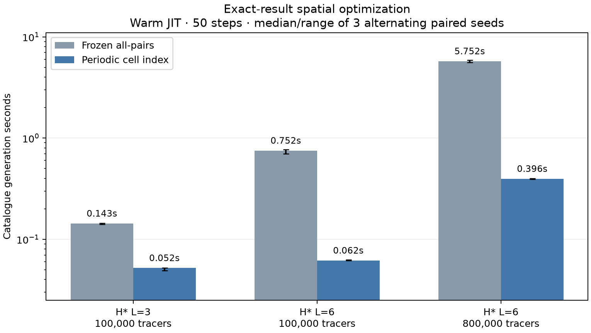

# Periodic spatial-index engulfment

Replace only the paper method's tracer engulfment with a bubble-to-cell CSR
index. Each bubble is inserted into the cells of its conservative periodic
bounding box. Each tracer checks only bubbles listed in its own cell, using
exactly the paper kernel's distance predicate and bubble order. Nucleation RNG,
birth ordering, timestep and float32 arrays remain unchanged. The frozen paper
source and all-pairs driver are preserved.

Paired warm-JIT timings, H=beta=1, v=0.5, tau=0..2.5, dt=0.05 (50 steps),
8 Numba threads. Three seeds, alternating baseline/indexed order. Medians in s:

| H* L | Tracers | Baseline generation | Indexed generation | Generation speedup | Engulfment: baseline → indexed |
|---|---|---|---|---|---|
| 3 | 100,000 | 0.1434 | 0.0521 | 2.75x | 0.1065 → 0.0150 |
| 6 | 100,000 | 0.7525 | 0.0618 | 12.18x | 0.7103 → 0.0209 |
| 6 | 800,000 | 5.7520 | 0.3964 | 14.51x | 5.4397 → 0.0936 |

All nine paired runs matched **exactly**: birth times, positions, ordered
survivor counts at all steps, internal F, and independent probe arrival maps.
Each worker also passed the same 162 identical-input checks (54 geometry cases,
three cell resolutions), covering random periodic geometry, empty inputs,
zero/large radii, full coverage, tangency/nextafter and face/corner wraparound.
The capped-index fallback reproduced a full baseline realization exactly.
The full 23-test suite passed with the native field adapter enabled; three
new optional-Numba tests also check against an independent NumPy union.

At 800,000 tracers, engulfment drops from 5.440 to 0.0936 s (58.1x),
while total generation drops from 5.752 to 0.3964 s (14.5x). The remaining
0.295 s in the non-engulfment component includes RNG draws, coordinate gathers,
bubble insertion and bookkeeping. Phase medians need not sum exactly to the
median total. The new dominant cost is outside engulfment.

Uses 16 cells/axis and rebuilds the index each step. Index entries are int32;
8 million references cap their allocation at about 30.5 MiB, plus offsets,
per-bubble bounds and counts. If the cap is exceeded, use the original all-pairs
kernel. Tiny cases may not benefit from rebuilding an index; different cell
resolutions and other cosmologies/parameter regimes have not been benchmarked.
The largest worker peak RSS was 250.1 MiB; this includes warm-up, JIT/runtime
and both methods in one process, not separate per-method memory measurements.

This preserves the reference method's finite-tracer and outer-timestep bias.
It is a computational speedup, not a fix for that stochastic-model bias or a
new analytic-accuracy claim. It does not accelerate the separate Python Poisson
sampler or arrival-map projection. No field evolution is included.

[Contract](../../OPTIMIZATION_EXPERIMENT.md) ·
[Implementation](../../spatial_engulfment.py) ·
[Paired benchmark](../../benchmark_engulfment.py)

```sh
MPLCONFIGDIR=/tmp/afopt-mpl python3 checks/stochastic/benchmark_engulfment.py \
  --output outputs/stochastic/engulfment-index-new
```

Use a fresh output directory. To use the optimized tracer driver in another
experiment, call `accelerated_paper(paper)` before passing that namespace to
`simulate`. The ordinary `paper` namespace retains the all-pairs implementation.
Raw catalogues, exact source snapshots, provenance and individual/per-step
measurements are preserved in `outputs/stochastic/engulfment-index-reference/`.


