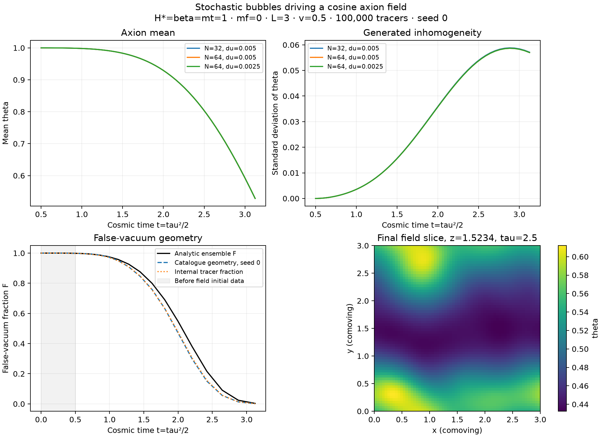

# First stochastic axion field run

The indexed tracer catalogue now drives actual CosmoLattice PV2 evolution of
a cosine axion in prescribed radiation expansion. Five field runs completed;
all predeclared transfer, reference, timestep and spatial checks passed.

Parameters: H*=beta=mt=omega_star=f_axion=1, mf=0, L=3, v=0.5,
100000 tracers, seed 0, outer nucleation dt=0.05 from tau=0 to 2.5.
The resulting 614-bubble catalogue exactly matches the original all-pairs
version and is held fixed across field/grid comparisons. Catalogue generation
with warmed JIT took 0.0627 s. Phase transitions use exact periodic first
arrivals; constant-speed bubble overlap is a union without collision forces.

Field initial conditions: theta=1, theta'=0 at tau=1,t=0.5,a=1.
This is an imposed finite-time initial state even though the catalogue includes
earlier bubble births. End tau=2.5,t=3.125,a=2.5; solver u=tau-1.
Mass squared follows the existing smooth first-arrival front:
0.5[1+tanh((tau-arrival)*v/0.15)], comoving wall width 0.15, including
precursor tails. Geometric true vacuum means arrival<=tau; geometric false
vacuum means arrival>tau. Smooth mass values are a separate observable.
There is no feedback from the axion onto bubble nucleation/growth or expansion.

| Ngrid | du | Steps | Arrival-map projection (s) | Field subprocess wall (s) | Native evolution (s) | Nested mass update (s) |
|---|---|---|---|---|---|---|
| 8 | 0.005 | 300 | 0.006 | 0.025 | 0.003 | 0.001 |
| 8 | 0.0025 | 600 | 0.006 | 0.022 | 0.005 | 0.001 |
| 32 | 0.005 | 300 | 0.282 | 0.128 | 0.091 | 0.051 |
| 64 | 0.005 | 300 | 1.957 | 1.096 | 0.940 | 0.361 |
| 64 | 0.0025 | 600 | 1.957 | 2.027 | 1.882 | 0.662 |

Maps are constructed only once per grid and reused for timestep refinement;
repeated values in the table do not mean repeated projection cost. Projection
is currently the exact brute-force Python implementation. Mass updates are
already included in native phase timings and must not be added again.
The irregular catalogue arrival map lacks the repeated values that accelerated
the earlier centered single-bubble mass-cache benchmark.

At N=64,du=0.0025, final mean theta=0.52841542 and spatial standard deviation
0.05698578 (initial standard deviation zero). Geometric F on this lattice is
0.00138092, while mean smooth m^2 is 0.93951980. The run has reached mostly
converted geometry but not a spatially constant final mass. No late-time
particle number or axion abundance is claimed.

Validation evidence:

- Every saved arrival value transfers exactly. At initial, midpoint and final
  times, every local mass agrees with Python and field moments/potential agree
  with history; scale factor and time mappings agree.
- Independent DOP853 on the same N=8 periodic semi-discrete cosine PDE gives
  max theta error 5.85e-6 at du=0.005 and 1.46e-6 at du=0.0025 (4.00x reduction).
  Corresponding maximum canonical-momentum errors are 2.75e-4 and 6.88e-5.
- Halving du at N=64 changes the final field by RMS 1.24e-6, normalized to
  theta_initial=1.
- N=32 versus block-averaged N=64 final theta differs by RMS 5.12e-4.
  Walls span 1.6 and 3.2 cells; this is an initial resolution check, not a
  demonstrated spatial continuum limit.
- The repository's 23 tests pass with the native field adapter enabled.

The analytic F curve shown in the figure is the ensemble reference; the
catalogue geometry is one seeded realization, not an ensemble estimate of
agreement. The indexed method retains the paper tracer model's finite-site
and outer-timestep effects. Ordinary energy conservation is not imposed for
an expanding field with prescribed changing mass. Snapshot summaries contain
physical kinetic, gradient and potential densities; no false conservation or
final abundance test is inferred from them.

[Predeclared contract](../../FIELD_EXPERIMENT.md) ·
[Driver](../../run_field.py)

```sh
MPLCONFIGDIR=/tmp/afopt-mpl python3 checks/stochastic/run_field.py \
  --output outputs/stochastic/field-new
```

Use a fresh output directory. Complete binary states, catalogue, reference,
inputs, logs, exact source snapshots and native timings are preserved under
`outputs/stochastic/field-reference/`; compact histories and provenance are here.


