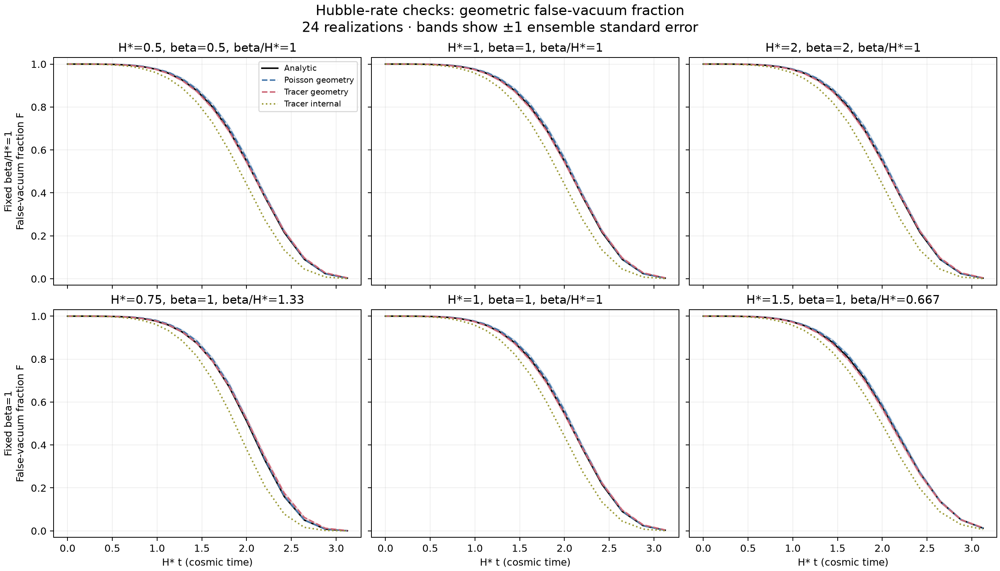

# Hubble-rate survival results

All predeclared Poisson, reference, rate-resolution, geometry and scale gates
passed. The 20 repository tests also passed with the native adapter enabled.
See [experiment contract](../../HUBBLE_EXPERIMENT.md) and
[driver](../../run_hubble.py). No field evolution was run.

At beta/H=1, H=0.5,1,2 give identical analytic curves and exactly identical
normalized same-seed Poisson probe arrival maps. This tests covariance under
rescaling H; it does not represent three independent dimensionless ensembles.
Both tracer geometric and internal mean curves also coincide in this scan.
At fixed beta=1, H=0.75,1,1.5 change beta/H and hence survival versus H*t.
Poisson means agree with the corresponding reference within the declared
4 ensemble SE + 0.005 absolute-F tolerance at every observation time.
That tolerance does not establish relative precision in the small late tail.

All cases keep H*L=3, v=0.5, H*tau_end=2.5 (H*t_end=3.125),
H*dt=0.05 for tracers; 257 rate nodes, 24 seeds, 2048 tracers/probes.
Largest linear-rate reference error: 7.04e-5 absolute F; 257-to-513 node
change: 5.28e-5. Cosmic/conformal reference difference <2.84e-14.
All bubble radii stay below L/2 so the Euclidean-volume survival is valid.

Endpoint F at H*t=3.125; uncertainties are ensemble standard errors:

| H* | beta | Analytic F | Poisson geometry | Tracer geometry | Tracer internal | Poisson / tracer seconds (24 runs) |
|---|---|---|---|---|---|---|
| 0.5 | 0.5 | 0.003176 | 0.002523 ± 0.000362 | 0.004272 ± 0.000495 | 0.000793 | 8.06 / 1.35 |
| 1 | 1 | 0.003176 | 0.002523 ± 0.000362 | 0.004272 ± 0.000495 | 0.000793 | 8.69 / 0.67 |
| 2 | 2 | 0.003176 | 0.002523 ± 0.000362 | 0.004272 ± 0.000495 | 0.000793 | 8.85 / 0.69 |
| 0.75 | 1 | 0.000395 | 0.000264 ± 0.000106 | 0.001139 ± 0.000209 | 0.000000 | 22.32 / 0.77 |
| 1.5 | 1 | 0.012420 | 0.012716 ± 0.001235 | 0.014445 ± 0.001331 | 0.006165 | 3.75 / 0.56 |

Internal tracer survival remains systematically below the geometric estimator.
For H=0.75,beta=1 all tracer populations were exhausted (internal F=0),
while independently probed geometric F remains positive. Finite tracer
population and imposed outer timestep remain unresolved sources of bias;
these runs do not establish accuracy of the paper's 100,000-tracer method.

Total timed batches: 55.72 seconds (240 realization executions). Times include
validation and compressed output; Poisson also evaluates phantom arrival maps
and audits accepted births. First tracer batch includes JIT compilation.
Not a kernel-speed comparison. Raw catalogues/source snapshots remain in
`outputs/stochastic/hubble-reference/`. Frozen source hashes and library
versions are in summary.json. Poisson/probes use NumPy default_rng (PCG64);
tracers use legacy np.random.seed (MT19937). Probe SeedSequence=[92842,seed],
shared in normalized space across H to support the scale-covariance comparison.

