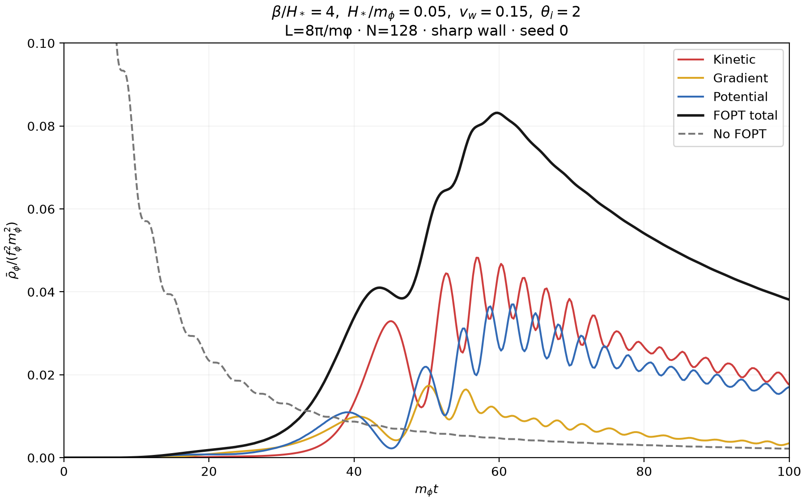
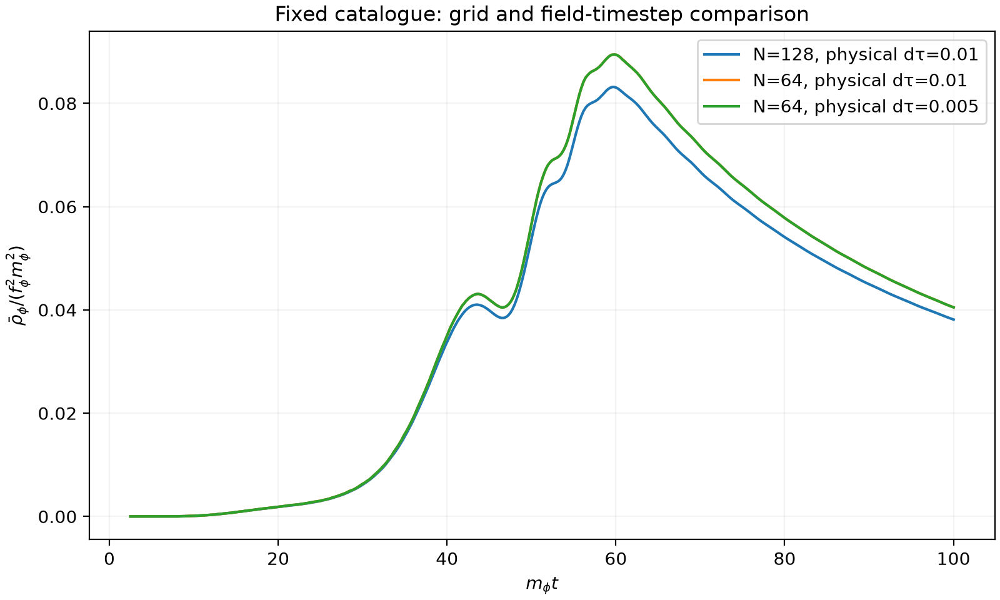

# Energy evolution with Fig.2 physical parameters

Actual CosmoLattice runs at the physical parameters stated for Fig.2 of
[Axion Misalignment Across First-Order Phase Transitions](https://arxiv.org/pdf/2607.01333):
H*/m_phi=0.05,beta/H*=4,v_w=0.15,theta_i=2,L*m_phi=8*pi,Ngrid=128.
The mass is exactly zero outside the first-arrival union and m_phi=1 inside;
wall_width=0 (sharp switch). Energy is rho_bar/(f_phi²*m_phi²), cosmic
horizontal coordinate m_phi*t. Colors follow the paper. The no-FOPT dashed
curve is the independent regular early-time nonlinear homogeneous cosine
solution with theta_i=2, rather than a field reinitialized at the lattice start.

The new seed-0 catalogue contains 18844 bubbles, using 100000 tracers and
fixed conformal birth/engulfment timestep 0.01. Positions and births are
unchanged by field grid/timestep comparisons. Geometry uses the exact growing
periodic bubble union, never a forced completion flag when tracers disappear.
This is a fresh stochastic realization, not a replay of an unpublished paper
seed. The original source kernels remain read-only. Generation took 5.19 s
including JIT startup (not a warm-JIT benchmark).

Large-catalogue projection uses a cell lower-bound search. N8 full-map and
256 random N128-cell checks agreed exactly with the brute-force oracle on this
catalogue. Additional empty/random/cell-resolution unit tests passed. N128 map
projection took 0.745 s; N64 took 0.099 s after warming the projector. These
specific timings are not a general paired performance comparison.

The first birth is at physical tau=15.58, cosmic t=6.0684. Field initial data
are placed at tau=10,t=2.5, before any birth, with theta=2 and theta'=0.
The sharp-mass field is exactly frozen and has zero energy at all earlier
times, so the finite numerical start omits no axion evolution in this seed.
Final physical tau=63.25,t=100.014. The catalogue ends at tau=55, by which time
all N128 cells have converted (latest grid arrival tau=51.5624). The finite
tracer simulation and its uncertainties still require separate convergence
checks; a single curve is not an ensemble survival certification. survival.csv
records geometric/internal/analytic fractions for inspection.

Because the adapter requires a_initial=1, use the coordinate gauge factor
c=a_physical(initial)=0.5: x_program=c*x_physical,
tau_program=c*tau_physical,a_program=a_physical/c.
Program lSide=4*pi corresponds exactly to the paper's physical comoving
L=8*pi in a*=1 normalization; no physical box size was halved. Native H0=0.2
is the physical Hubble parameter at t=2.5, not H*=0.05. The physical density
is invariant under this coordinate change. All scale/time transfers were checked.

| Ngrid | Physical dtau | Field subprocess (s) | Peak normalized energy | Final normalized energy |
|---|---|---|---|---|
| 128 | 0.01 | 51.41 | 0.083174 | 0.038128 |
| 64 | 0.01 | 11.87 | 0.089454 | 0.040490 |
| 64 | 0.005 | 22.87 | 0.089447 | 0.040487 |

N128 peak is 0.083174 at m_phi*t=59.7803; final density is 0.0381282.
No-FOPT density at the same endpoint is 0.00219357. These single-realization
endpoint values do not by themselves establish a final relic abundance.
N64 halving dtau changes final total by 0.00697%; N64-to-N128 changes it
by 5.83%, demonstrating remaining spatial discretization effects. Native
potential/kinetic/gradient/total at initial, intermediate and final snapshots
match independently computed Python physical energy within 1e-10. Every
arrival and sharp mass value transfers exactly. All 25 repository tests pass.

Numerical differences from the published calculation remain: the current
CosmoLattice PV2 solver uses a nearest-neighbor Laplacian and compatible forward
energy gradient; the pinned paper source uses fourth-order finite differences.
The paper's adaptive timestep is replaced by a fixed timestep, and the seed is
new. Thus matching physical parameters is not a claim of numerical identity
or a measured error against digitized author data. The no-FOPT early branch is
clipped by the displayed y range, matching the paper-style late-scale view.

Native energy diagnostics now support expansion, using K=<pi²>/(2a^6) and
G=<forward gradient²>/(2a²). Sharp mass switches inject energy discretely;
the smooth-profile source column is zero in this mode and must not be used
to infer absence of that energy transfer. No closed-system conservation claim
is made. The test suite checks expanded diagnostic energies against states.

[Predeclared field contract](../../PAPER_FIGURE2.md) ·
[Preparation](../../prepare_paper_figure2.py) ·
[Field driver](../../run_paper_figure2.py)

```sh
PYTHONPATH=src python3 checks/stochastic/prepare_paper_figure2.py \
  --output outputs/stochastic/paper-figure2-new
MPLCONFIGDIR=/tmp/afopt-mpl python3 checks/stochastic/run_paper_figure2.py \
  --source outputs/stochastic/paper-figure2-new \
  --output checks/stochastic/results/paper-figure2-new
```

Fresh directories required. Raw snapshots, arrival maps, catalogue, native
histories, inputs/logs and source snapshots remain under
outputs/stochastic/paper-figure2/. Compact CSVs, PNG/PDF plots and provenance
are saved here.




