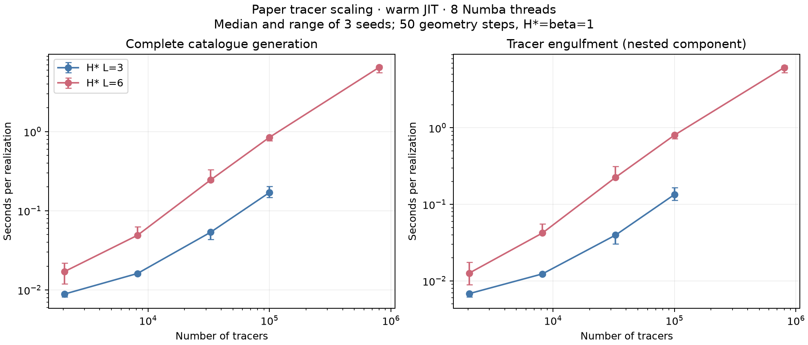

# Tracer timing and volume scaling

Measured the pinned paper geometry reference on the local laptop: H=beta=1,
v=0.5, tau_end=2.5, fixed outer dt=0.05 (50 steps), 8 Numba threads.
Three seeds per configuration; times below are medians in seconds. Each
configuration runs in a fresh process, with JIT warm-up outside timings.
Profiling wrappers exactly reproduced plain-driver catalogues and internal
survival on each warm-up. Bounds, monotonicity and timing partition checks passed.

| H* L | Tracers | Generation | Engulfment (within generation) | 2048-probe arrival | Bubble count (median) | Process peak RSS (MiB) |
|---|---|---|---|---|---|---|
| 3 | 2,048 | 0.0089 | 0.0068 | 0.0150 | 590 | 168.5 |
| 3 | 8,192 | 0.0161 | 0.0124 | 0.0156 | 618 | 172.6 |
| 3 | 32,768 | 0.0536 | 0.0397 | 0.0185 | 729 | 174.9 |
| 3 | 100,000 | 0.1702 | 0.1345 | 0.0176 | 692 | 166.2 |
| 6 | 2,048 | 0.0170 | 0.0127 | 0.0443 | 1672 | 172.7 |
| 6 | 8,192 | 0.0490 | 0.0422 | 0.1042 | 3613 | 172.4 |
| 6 | 32,768 | 0.2452 | 0.2256 | 0.1318 | 5013 | 176.0 |
| 6 | 100,000 | 0.8473 | 0.8030 | 0.1543 | 5621 | 183.7 |
| 6 | 800,000 | 6.4940 | 6.1335 | 0.1586 | 5717 | 253.7 |

At 100,000 tracers, engulfment accounts for approximately 79% (L=3) and
95% (L=6) of generation, using ratios of phase medians. This is the dominant
cost: the paper's parallel kernel loops over active tracers and bubbles,
with early exit when a containing bubble is found. Its num_hash_cells argument
is unused; this is an all-pairs kernel, not a working spatial hash.

At fixed volume, 32,768 to 100,000 tracers raises runtime by approximately
3.2x (L=3) and 3.5x (L=6), for a 3.05x increase in count. At fixed tracer
density, L=3,N=100000 to L=6,N=800000 increases volume/tracer count eightfold
but runtime 38.2-fold (0.170 to 6.494 seconds). More tracers and more bubbles
make large volumes costly. These are measured ranges, not a universal
power-law fit or an extrapolation to different beta/H, dt, velocities or volume.

Persistent initial positions and active indices require 20 bytes/tracer:
1.91 MiB at 100,000 and 15.26 MiB at 800,000. Temporary draws, gathered
coordinates, masks, bubble arrays and JIT/runtime add to memory. Process peak
RSS includes Python/Numba and warm-up, and can vary between fresh processes;
it is not the incremental memory cost of tracer arrays.

The analytic endpoint is F=0.00317592 for both volumes. L=6,N=2048 exhausted
its internal tracer pool in all three runs, while geometric F averaged 0.04020.
Finite tracer density affects the simulated bubble catalogue, not just the
internal estimator. Only three realizations were used: accuracy convergence,
particularly in the small tail, is not certified by this performance study.
Shared seed numbers across populations do not represent identical candidates.

This benchmark excludes independent arrival measurement, quadrature, JIT,
compressed output and plotting from generation times. It is geometry only;
no axion field or field mass-update cost is included. Fifty geometry steps
are much fewer than the 1280 steps of the earlier field benchmark, so those
elapsed times must not be compared directly. Source parameters/hashes and
individual timings are in summary.json; per-step active counts and bubble
counts give upper bounds on distance-comparison workload (early exits reduce
actual comparisons). Raw catalogues and source snapshots remain in the two
output directories listed there. A density-only plotting bug was repaired
and figures regenerated from saved results without rerunning any ensembles.

A practical next acceleration is a periodic spatial index for engulfment.
Validate survivors on identical tracer/bubble inputs against the frozen
all-pairs kernel before timing it. Do not combine a sampler change and a
geometry optimization in the same claimed speedup.

[Predeclared contract](../../SCALING_EXPERIMENT.md) ·
[Reproducible benchmark](../../benchmark_tracers.py)

