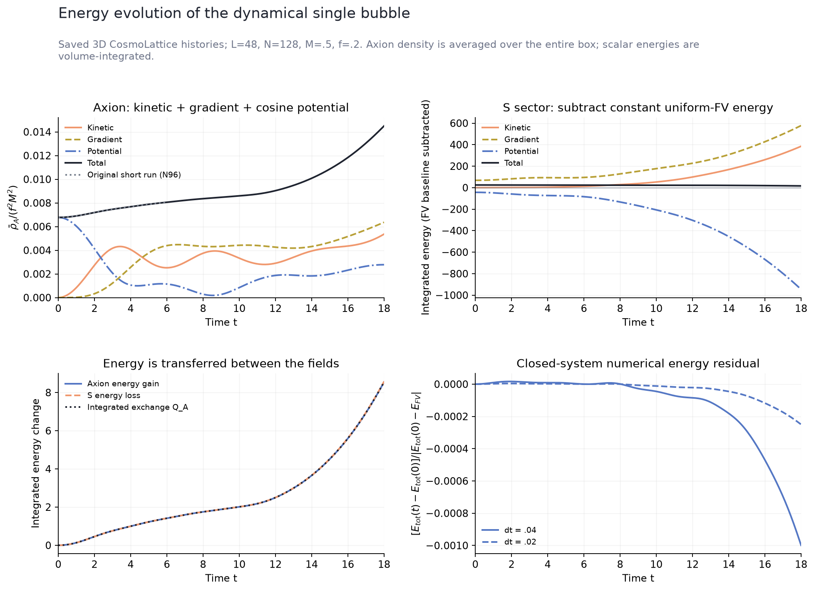
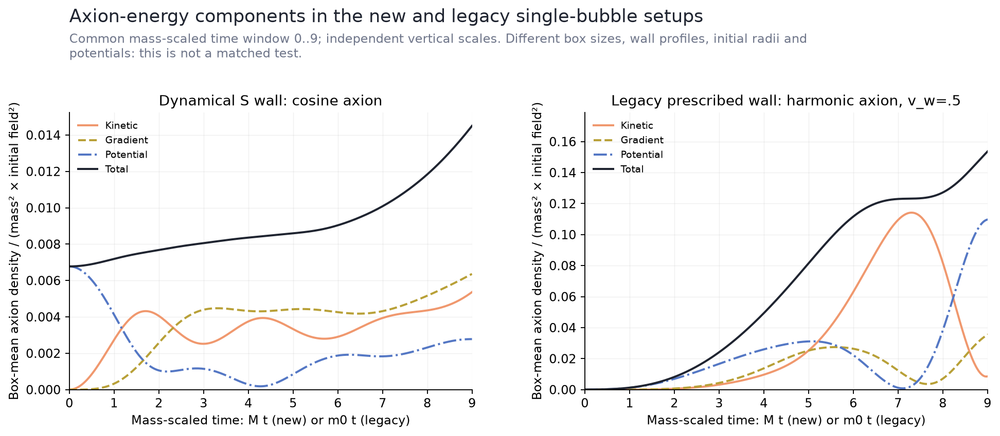
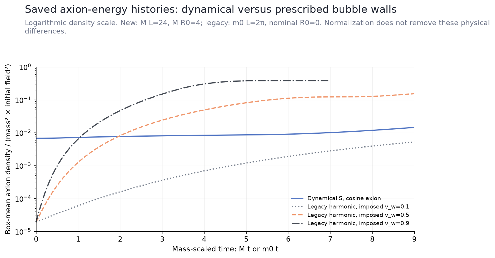

# Energy evolution and comparison with the existing single bubble

2026-10-19. Read-only plotting of saved simulation histories; no new solver
run. The comparison target is checks/single_bubble, the existing non-expanding
prescribed-wall harmonic calculation. The original t<=6 dynamical run is also
overlaid on the new axion-energy panel to show the extension in time.
This second rendering improves header spacing; the first rendering remains
preserved in ../energy-comparison-01 with the same underlying source data.



## Definitions and new-run findings

The main run has L=48, N128, M=.5, f=.2, theta_i=1, with no expansion.
For the canonical axion A=f theta, volume-integrated components are

    K_A = integral A_dot^2/2 d^3x
    G_A = integral sum(forward differences of A)^2/2 d^3x
    V_A = integral f^2 M^2 S^2 [1-cos(A/f)] d^3x.

The plotted box-mean axion density divides each by L^3 f^2 M^2. It does
not divide by only the converted volume. The S panel uses integrated energies;
only its potential and total have the constant uniform-false-vacuum baseline
E_FV=DeltaV*L^3 subtracted. Negative baseline-subtracted potential is therefore
expected and does not mean the unshifted potential becomes negative.

At t=18 (Mt=9):

| Axion component | Box-mean density / (f² M²) |
|---|---:|
| Kinetic | .00536253 |
| Gradient | .00636179 |
| Cosine potential | .00277741 |
| Total | .01450174 |

The integrated axion energy grows from 7.49225 to 16.03776, a gain of 8.54551.
Kinetic and potential components oscillate, while the gradient contribution
builds up. The total axion energy is not conserved separately because

    dE_A/dt = integral 2 f^2 M^2 S S_dot [1-cos(A/f)] d^3x = Q_A.

The S sector supplies the opposite transfer. The lower-left plot compares
the measured gain/loss and integrated Q_A. The lower-right plot shows total
numerical energy drift divided by the initial energy excess over uniform FV.
Halving the timestep reduces its maximum by approximately four. This finite
discretization error is retained rather than described as exact conservation.

The histories are the original long-run CSVs. Their tiny naive-summation
roundoff remains; see the earlier [diagnostic repair](../single-bubble-long-01/README.md).
Endpoint compensated replay passed the unchanged gate, but full compensated
time histories were not regenerated. The energy curves here do not silently
replace those original data.

## Comparison with checks/single_bubble



The component comparison uses the refined legacy v_w=.5,N128,ref2 history.
Both use mass-scaled time and density divided by mass squared times initial
canonical field squared. The panels have independently labelled vertical
scales, so component shapes are visible. Equal normalization does not make
their inputs equivalent.

| Input | Dynamical S single bubble | Existing prescribed single bubble |
|---|---|---|
| Axion potential | cosine | harmonic / quadratic |
| Wall dynamics | coupled S equation | prescribed constant speed |
| Wall speed | measured, initially zero | fixed .1, .5 or .9 |
| Mass profile | m²=M² S² | m²=m0²[1-tanh((r-v_w t)/delta)]/2 |
| Mass-scaled box | M L=24 | m0 L=2 pi |
| Initial nominal bubble radius | M R0=4 | 0, with retained smooth core/tail |
| Mass-scaled seed/wall parameter | M w=1 for S, then square for m² | m0 delta=.15 for m² |
| Initial canonical amplitude | A_i=f=.2, theta_i=1 | phi_i=1 |
| Initial axion velocity | 0 | 0 |
| Background | Minkowski | Minkowski |
| Energy source | transfer from dynamical S | explicit prescribed-mass work |



The total overlay is logarithmic and shows the common time interval 0..9 in
mass units. The legacy v=.9 curve stops at its actual saved endpoint 6.9813;
it is not extrapolated. The other legacy curves continue beyond the displayed
window in their source files. The new curve begins with appreciable potential
energy because a finite bubble already exists; legacy initial energy comes
only from its small smooth mass tail.

The old small periodic box reaches a very different conversion state during
this interval. Whole-box averaging is sensitive to that difference. These
curves therefore establish the recorded behavior of each existing setup; no
ratio is interpreted as suppression/enhancement caused by adding S. Isolating
that effect would require a new matched control with the same potential,
initial radius/profile, mass, box, initial field and declared wall trajectory.
Such a control was not run as part of this plotting request.

## Validation and reproducibility

All loaded columns are finite. Axion component sums match the native axion
total to max absolute 1.57e-11; scalar components match to 2.30e-8 (the original
naive reduction roundoff). The independent component identities are checked
before plotting. Legacy energy gains were also checked against integrated
prescribed-mass work; largest relative residual across full saved runs is
3.47e-5 with the source quadrature used here. This is a separate full-history
diagnostic from the archived endpoint-only legacy acceptance statistic.

[summary.json](summary.json) records these checks, exact source hashes and
normalizations. [new_energy.csv](new_energy.csv) and three legacy energy CSVs
retain time, components, totals and source terms. PNGs have visually inspected
labels and legends; corresponding SVGs permit vector export. Sources and
simulation reports remain unchanged.

Run from the repository root with a fresh destination:

```sh
MPLCONFIGDIR=/tmp/afopt-mpl python3 checks/stochastic_v2/plot_energy_comparison.py \
  --output checks/stochastic_v2/results/energy-comparison-new
```

The chart contract records the local plotting-skill dependency limitations.
These are standard Matplotlib scientific figures, not a claim of full plugin
template or unavailable preflight compliance. All panels use lines because
the questions concern continuous simulated time evolution, component exchange
and temporal residuals, not unrelated category comparisons.
