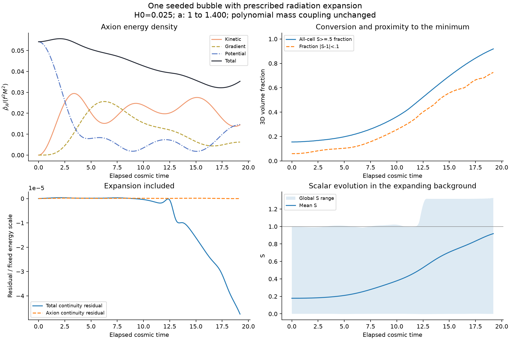

# One bubble with prescribed radiation expansion

The coupled polynomial model now evolves on a prescribed radiation background.
All prospective reference, accounting and pilot-refinement gates passed.
See [inputs](../../COSMOLOGY_INPUTS.md), [contract](../../EXPANSION_STOCHASTIC_CONTRACT.md),
[report](report.json), [independent validation](validation.json), and
[history](history.csv). Prior static runs and their failed gates are retained.

Main: L24,N96,du=.02,H0=.025,u0..16; a1..1.4, cosmic elapsed t0..19.2.
Initial R8,w2 tanh bubble, theta=1, zero momenta. Actual CosmoLattice PV2,
full reciprocal axion force. Canonical momenta P=a² X_prime, not X_dot.

| Control | Final Ebar_A | Fraction S>=.5 |
|---|---:|---:|
| N96,du=.02 | 4.87838328 | .91870117 |
| N64,du=.02 | 4.87614812 | .91717529 |
| N96,du=.01 | 4.87847694 | .91870117 |

Final axion-energy changes are .0458% spatial and .00192% temporal. Main
maximum total/axion continuity residuals are 4.75e-5 and 1.92e-7 of initial
energy. Endpoint energy recomputation agrees to 3.30e-17 in that normalization.
The N4 independent DOP853 tests show second-order convergence, finest component
errors about1.25e-6; H0=0 reproduces all six static endpoints exactly.

The wall is resolved by at least five cells during the declared pre-interaction
spherical diagnostic. That diagnostic stops at u7.6 when its periodic isolated
bubble assumption fails. There is no claim about late-time wall convergence,
complete conversion, a settled vacuum, or a measured relic abundance. The
background is prescribed, and no bath/reheating or Friedmann solve is included.
This is the polynomial model, not the exponential Marsh/pockets setup.



[Central-slice animation](cosmology.gif). Coordinates are comoving; energies
are physical densities integrated over comoving volume. Physical box totals
are a³ times these integrals. This run is not a matched causal comparison
against the old static long runs, whose box and durations differ.

Reproduce from repository root, choosing fresh output directories:

```sh
python3 checks/stochastic_v2/build_expanding_backend.py --output build/stochastic-v2-expansion-02
python3 checks/stochastic_v2/validate_expansion.py --executable build/stochastic-v2-expansion-02/bubble_evolve --static-reference outputs/stochastic_v2/phase-backend-validation-01 --output outputs/stochastic_v2/expansion-validation-01
python3 checks/stochastic_v2/run_expansion_pilot.py --executable build/stochastic-v2-expansion-02/bubble_evolve --validation outputs/stochastic_v2/expansion-validation-01/report.json --output outputs/stochastic_v2/expanding-single-bubble-01
python3 checks/stochastic_v2/plot_cosmology.py --source outputs/stochastic_v2/expanding-single-bubble-01 --output checks/stochastic_v2/results/expanding-single-bubble-01
```

Raw states and source copies: outputs/stochastic_v2/expanding-single-bubble-01/.
The archived report contains build/source/library hashes and refinement results.
