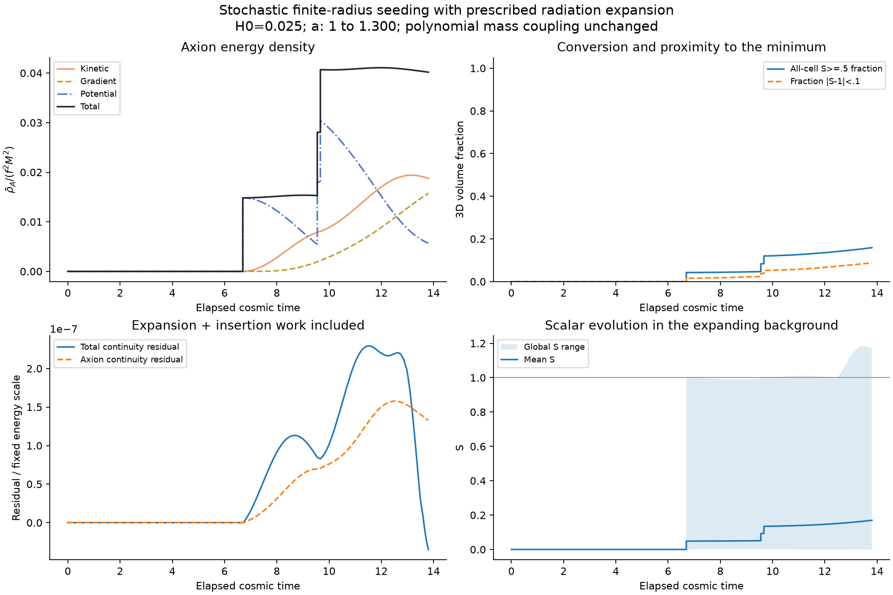

# Stochastic finite-radius seeds with radiation expansion

The first stochastic coupled-field pilot passed its declared reference,
energy-accounting and grid/timestep gates. Twelve Poisson candidates were
attempted; three seeds were accepted and nine rejected by the live finite-core
criterion. Both controls accepted the same three events. This is one short
realization, not a completed transition, ensemble result or relic abundance.

Use [all inputs and equations](../../COSMOLOGY_INPUTS.md) and the
[prospective contract](../../EXPANSION_STOCHASTIC_CONTRACT.md).
Numerical evidence: [report](report.json), [history](history.csv),
[candidate file](candidates.txt), [event ledger](births.csv),
[independent insertion validation](validation.json), [Poisson audit](rate-audit.json)
and [rate table](rate.csv). Main raw output/source copies are at
outputs/stochastic_v2/expanding-stochastic-01/.

| Run | Accepted / attempted | Final Ebar_A | Fraction S>=.5 |
|---|---:|---:|---:|
| L32,N96,du=.02 | 3 / 12 | 13.16586946 | .15886321 |
| L32,N64,du=.02 | 3 / 12 | 13.17445435 | .15884399 |
| L32,N96,du=.01 | 3 / 12 | 13.16579632 | .15886321 |

All runs use H0=.025,u0..12,a1..1.3, cosmic elapsed t0..13.8, initial
S=0,A=.2 and P=0. The unchanged potential has lambda2,DeltaV.06,M.5,f.2.
Full reciprocal axion backreaction is included. Candidates use the old
Poisson sampler with q=Gamma*a^4; wall-speed metadata and arrival maps do not
control the scalar. The physical rate is Gamma=H0^4 exp(.4*t_elapsed).
Accepted seeds have physical R8,w2 and a compact taper to zero at radius16.
Acceptance requires |S|<=.05 throughout the physical core. It is stricter than
point rejection and is not microscopic tunnelling physics.

The Poisson audit gives expected count15.65189, mean15.640625 and variance
15.11740 across256 seeds; quadrature error3.98e-6. Only seed0 was evolved.
The accepted births are at u6.21454,8.61986,8.71636. The initial seed's physical
10--90% width spans10.82--11.41 main-grid cells at these births (7.22--7.61
on N64). This checks insertion resolution, not every later wall's Lorentz
contraction or collision structure. The final S range is approximately
[-.001156,1.171591]; a phase-threshold fraction is not a relaxed-vacuum test.

Final axion-energy changes are .06521% between grids and .0005555% when
halving du. Maximum total/axion continuity residuals, including Hubble work
and all insertion jumps, are 2.29e-7 /1.58e-7 of the fixed energy scale1990.63.
Independent endpoint accounting agrees to2.28e-16 in this normalization;
seed-map error<1.4e-15 and jump-accounting error<3.3e-14.
The piecewise independent DOP853 test has finest state error6.06e-6 and
refinement ratios3.82,3.88. Its no-event regression differs from the expansion
driver by5.0e-16. See validation.json for every gate.

## Where the axion energy comes from

Initial axion energy is zero. Even though an insertion leaves A and P_A
unchanged, it turns on the S-dependent axion potential. In the main run,
the final energy ledger, in the Ebar convention, is approximately

    Ebar_A(final) = 13.190800 (insertion work)
                    + 2.624342 (continuous transfer from S)
                    - 2.649536 (expansion loss)
                    + .000264 (numerical balance residual)
                  = 13.165869.

The residual is about2.01e-5 of final axion energy. Large jumps in the plot
are imposed seed work; they must not be interpreted as dynamically generated
axions between nucleations. Total scalar-plus-axion insertion work is55.43048.
Reporting the full ledger makes future comparisons between seed prescriptions
possible. Physical box totals are a³ Ebar; these histories integrate physical
densities over COMOVING coordinate volume.



[Central-slice animation](cosmology.gif). The animation shows S, the evolving
mass squared M²S²/M², and theta on comoving axes; it is not a full-volume
conversion diagnostic. No imposed v_w, thermal bath, temperature-dependent
potential, Friedmann solve or reheating model is present. The potential is
the polynomial effective model, not the exponential Marsh/pockets model.
Further duration, volume/ensemble controls and wall-resolution studies are
needed before completion, survival or abundance claims.

## Reproduction

Run from the repository root and replace existing output names with fresh ones;
the tools refuse to overwrite. Existing library manifests are reused without
editing vendor code. The expansion prerequisite is documented in the sibling
expanding-single-bubble-01 result.

```sh
python3 checks/stochastic_v2/build_stochastic_backend.py --output build/stochastic-v2-insertion-03
python3 checks/stochastic_v2/validate_insertion.py --executable build/stochastic-v2-insertion-03/bubble_evolve --expansion-validation outputs/stochastic_v2/expansion-validation-01 --output outputs/stochastic_v2/insertion-validation-02
python3 checks/stochastic_v2/audit_candidates.py --output outputs/stochastic_v2/candidate-rate-audit-01
python3 checks/stochastic_v2/run_stochastic_pilot.py --executable build/stochastic-v2-insertion-03/bubble_evolve --validation outputs/stochastic_v2/insertion-validation-02/report.json --rate-audit outputs/stochastic_v2/candidate-rate-audit-01 --output outputs/stochastic_v2/expanding-stochastic-01
python3 checks/stochastic_v2/plot_cosmology.py --source outputs/stochastic_v2/expanding-stochastic-01 --output checks/stochastic_v2/results/expanding-stochastic-01 --stochastic
```

The initial rate audit was run through the same prepare_candidates function;
audit_candidates.py adds a convenience CLI and provenance. Frozen catalogue
SHA256: cc1e38a135e9cd039d3df3ab6da4eb41fff43e39c44c0d075b6fe7b3de125427.
The earlier insertion build01 compile failure and insertion-validation-01
abort on an empty optional parser default remain in build/outputs. A nonempty
`none` sentinel fixes that no-event configuration in passing build03; no
physical parameter or acceptance tolerance was changed to obtain passing runs.
