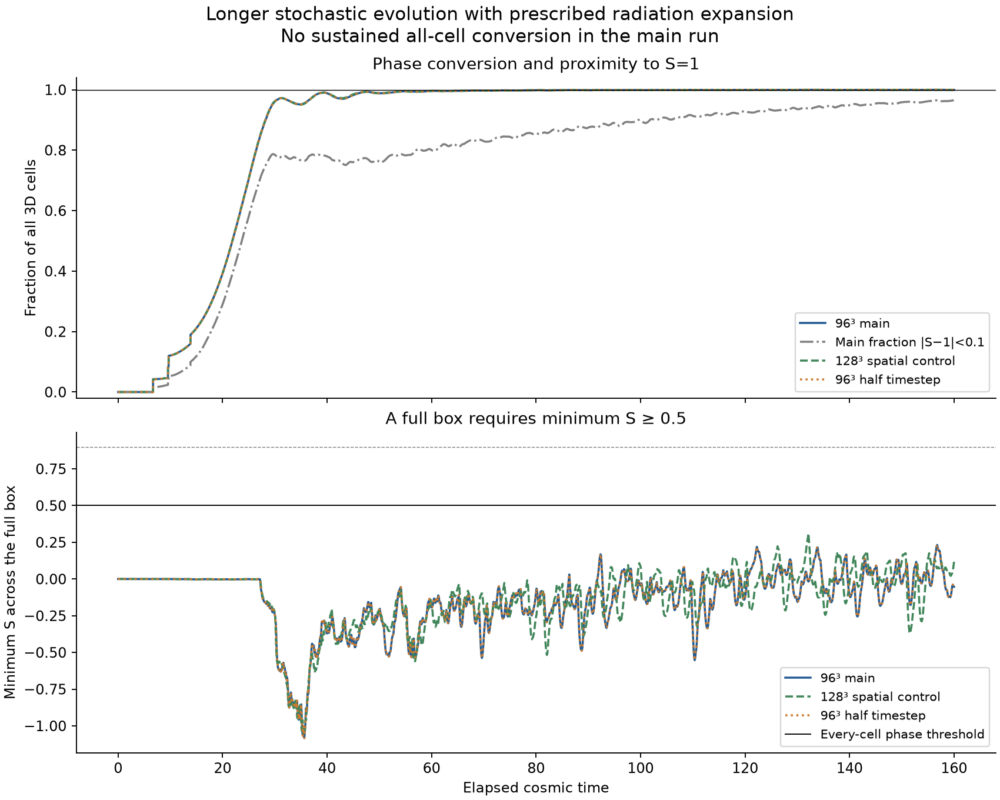
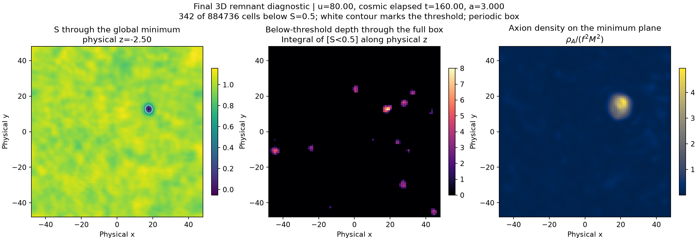
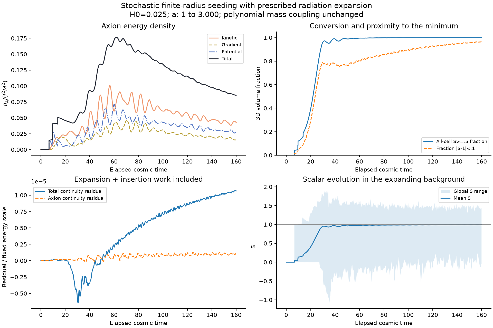

# Longer stochastic evolution: conversion and recrossing

The main run reached u=80 (elapsed cosmic time 160, a=3). Every cell on the
96³ grid was observed at S>=0.500001 at least once in the audited full
checkpoints. At the endpoint, 342 of 884,736 cells are below S=0.5:
99.9613% are above the phase threshold. All 342 endpoint cells had crossed
it earlier. There was no sampled time when all cells were simultaneously
above 0.5, hence no sustained full-box interval. The intended persistent
conversion criterion is unmet.

Both refinement controls are complete. Numerical gates pass; none of the
three runs meets the sustained-conversion goal. See the [combined report](report.json).
The missing onset checks are unsuccessful because no full-box interval exists.

| Run | Grid | Maximum late du | Final Ebar_A | Cells below 0.5 | Fraction above 0.5 |
|---|---:|---:|---:|---:|---:|
| Main | 96³ | .005 | 27.996557 | 342 | 99.96134% |
| Spatial control | 128³ | .005 | 26.812197 | 261 | 99.98755% |
| Half timestep | 96³ | .0025 | 27.997423 | 346 | 99.96089% |

Endpoint axion-energy differences are 4.23% spatially and 0.00309% temporally,
within the declared 10%/2% pilot gates. All runs use the same candidate file
and accept the same four seeds. Total continuity residuals decrease from
1.07e-5 to 2.68e-6 when halving the timestep, consistent with second order.

The residual regions are not quantitatively converged. At the same a=3,
their physical volumes are about 342 on N=96 and 110.1 on N=128; their cell
counts cannot be compared directly across different grids. The time-averaged
physical volume over u=72..80 is about 282.8 versus 214.6. These data support
continued recrossing on both tested grids, not a continuum remnant volume or
a claim of physical stability. Full-box filling is not established by these runs.



## What the main run establishes

[Checkpoint coverage](checkpoint-coverage.json) combines the replayed full
states at u=20,24,28,40,80. Their entire overlapping global histories match
exactly ([audit](checkpoint-replay.json)). Only 33 cells had not been seen
above threshold in the first four checkpoints; those are above threshold at 80.
This gives a bound on visited cells, not exact first-passage times. It does not
show simultaneous filling, permanent conversion, or continuum convergence of
the visited-cell map. The controls do not save the same intermediate full states.

The [main statistics](remnant-statistics.json) give final S range
[-0.0527614,1.4404704], S_std=0.0494222, and 96.4695% of cells within |S-1|<0.1.
The closest sampled approach still had 131 cells below 0.5 (u=78.84).
The maximum global minimum over the run was only 0.23202. Scalar oscillations
and localized recrossings remain; calling these stable pockets or oscillons,
or attributing their survival to axion pressure, requires separate evidence.
S<0.5 is a threshold region, not an exactly homogeneous massless S=0 vacuum.



The middle panel projects below-threshold depth through the whole 3D box.
The left slice passes through the global minimum, which a central slice can
miss. Axion-density localization is shown for comparison, not as a causal
pressure test. Axes here are physical; the animation uses comoving axes.

## Setup and accounting

See [the prospective contract and amendments](../../LONG_STOCHASTIC.md),
[physical inputs](../../COSMOLOGY_INPUTS.md), [main report](main-report.json),
[history](history.csv), [ODE/insertion validation](insertion-validation.json),
and [rejection/stop validation](validation.json). One realization, periodic L=32,
N=96, H0=0.025, lambda=2, DeltaV=0.06, M=0.5, f=0.2, initial S=0,A=0.2,P=0. Original
polynomial coupling and reciprocal axion force retained; no imposed wall speed,
new friction, temperature dependence, thermal noise or self-consistent gravity.

Maximum du=0.02 through u=12 and 0.005 afterwards, plus exact alignment to
non-certified events and output times. Histories every 0.04, slices every 0.2.
All original u<=12 histories are exact, as is the u=40 replay. No field clipping,
extra damping or forced completion. Actual elapsed conformal u is stored in
the legacy snapshot time slot; momenta are P=a²X_prime=a³X_dot.

There are four [accepted seeds](accepted-births.csv), at u=6.21454,8.61986,
8.71636,12.03359. The original 12 candidates are retained exactly; independent
Poisson increments are appended through u=28, giving 542,713 explicit candidates
([audit](candidate-audit.json)). Beyond u=28 every step has a sufficient proof
of globally empty seed eligibility ([proofs](empty_eligibility.csv)): 10,401
covering intervals, minimum witness bound 0.59188 > 0.05. No possible centre
can pass the same physical R=8 near-FV core rule. The increasing Gamma is retained;
the 5.28e27 EXPECTED later Poisson marks are marginalized because all would be
rejected. Their realized count/positions are not sampled or claimed.

Certified rejection rows in raw births.csv have certified_rejection=1, an
explicit lower witness bound, and NaN/0 for the unmeasured exact core maximum/
count. The full catalogue/ledger remain in outputs/stochastic_v2/; they are
not duplicated here. Global proof failure aborts the run.

Main maximum total/axion continuity residuals are 1.07e-5/1.31e-6 of initial
Ebar=1966.08. Independent endpoint energy error is 5.78e-17 in that normalization.
The [axion ledger](axion-ledger.json) is approximately

    final Ebar_A = 16.594017 (insertion work)
                    +109.032086 (continuous transfer from S)
                    -97.631762 (expansion loss)
                    +.002215 (balance residual)
                  =27.996557.

All energies are physical densities integrated over COMOVING volume;
physical total box energies are a³ times Ebar. The maximum axion residual is
about 0.0092% of final axion energy. This is not an abundance or matched legacy
enhancement measurement. The background is prescribed RD, not a solved
Friedmann/bath/reheating system; the polynomial potential is not Marsh's
exponential coupling.



[Central-slice animation](cosmology.gif). At u=80 the physical cell spacing is 1
on N=96 and 0.75 on N=128; late localized structures need their own resolution
study. Two grids do not establish continuum shapes, spectra or pocket stability.
The [spatial statistics](space-remnants.json) and
[time-refinement statistics](time-half-remnants.json) preserve these differences.

## Reproduction and retained failures

Run from the repository root with fresh output names. Existing output names
are evidence and the tools refuse to overwrite them. Existing CosmoLattice
libraries are reused; no vendor or sibling physics sources were edited.

```sh
python3 checks/stochastic_v2/build_long_backend.py --output build/stochastic-v2-cosmo-long-06
python3 checks/stochastic_v2/validate_insertion.py --executable build/stochastic-v2-cosmo-long-06/bubble_evolve --expansion-validation outputs/stochastic_v2/expansion-validation-01 --output outputs/stochastic_v2/long-insertion-validation-05
python3 checks/stochastic_v2/validate_rejection.py --executable build/stochastic-v2-cosmo-long-06/bubble_evolve --insertion-validation outputs/stochastic_v2/long-insertion-validation-05/report.json --output outputs/stochastic_v2/rejection-validation-06
python3 checks/stochastic_v2/extend_candidates.py --original outputs/stochastic_v2/expanding-stochastic-01/candidates.txt --end 28 --output outputs/stochastic_v2/long-candidates-28-01
python3 checks/stochastic_v2/run_long_stochastic.py --executable build/stochastic-v2-cosmo-long-06/bubble_evolve --validation outputs/stochastic_v2/rejection-validation-06/report.json --candidates outputs/stochastic_v2/long-candidates-28-01 --end 80 --stop-sustained 3 --output outputs/stochastic_v2/long-stochastic-until-01
```

For controls use --case space and --case time-half, the same --end 80 and
candidate directory, separate outputs, and no early stop. Each process uses
one CPU thread. No performance comparison is inferred from concurrent timings.
The main run took 612 seconds; concurrent spatial/time controls took 1,555 and
1,217 seconds. Raw fields, full histories/ledgers, inputs and
launch-time source copies are in outputs/stochastic_v2/long-stochastic-until-01/.
Build/source/library hashes are in the reports. Figure provenance is retained.

To reproduce the checkpoint coverage, also save matching full endpoints at
u=20,24,28,40 with the same initial data and frozen candidate prefixes. Use
extend_candidates.py for endpoint20/24/28 catalogues and the endpoint28 catalogue
with --end 40 for the last stage. Then run audit_checkpoint_coverage.py with
--source pointing to the long run and --checkpoints listing those four stage
directories. The audit checks their entire overlapping global histories before
combining the fields; it records binary-state hashes. Reproduction needs the
earlier validated pipeline and existing library manifests available in this
workspace. Compact histories are retained here; full states remain in outputs/.

The initial [certificate test](failed-rejection-diagnostic.json) had an
underresolved core that became empty; its refinement gate failed. A centred
core diagnostic exercises the intended path and passes without changing gates.
The [first accelerated comparison](failed-acceleration-coarse.json) and
[refined comparison to a coarse reference](failed-acceleration-refined.json)
also failed the local-momentum tolerance. A smaller late step and a matched
ordinary fine reference give the [passing comparison](matched-acceleration-audit.json).
All these failures, and the unmet u20/u24/u28/u40 completion outcomes, remain
recorded. They are not retroactively replaced by passing reports.
