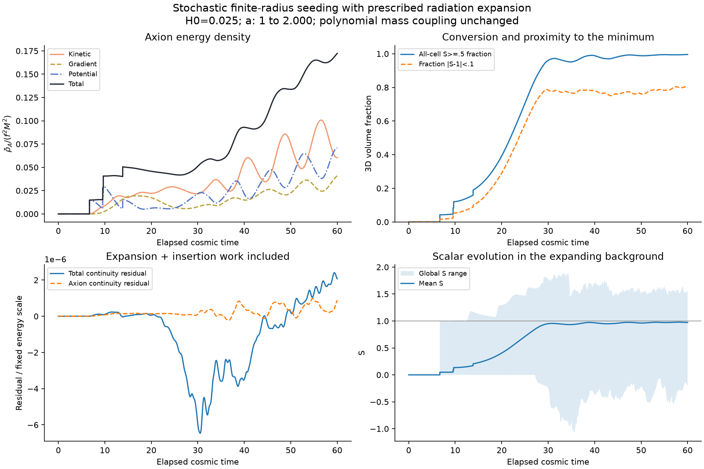

# Intermediate long-run checkpoint: u40

The unchanged stochastic model reaches99.5748% of cells S>=.5 by u40,
elapsed cosmic time60,a2. It has NO all-cell interval; completion is unmet.
S_min=-.194046,S_max=1.556964,S_std=.098782. This numerical checkpoint must
not be described as a completed transition or a relaxed vacuum.

See the [duration contract and amendments](../../LONG_STOCHASTIC.md),
[report](report.json), [history](history.csv) and [exclusion proofs](empty_eligibility.csv).
Physical model inputs remain in [COSMOLOGY_INPUTS.md](../../COSMOLOGY_INPUTS.md).
Main N96,L32,base du=.02 through u12, late cap du=.005. Four accepted seeds,
at u6.21454,8.61986,8.71636,12.03359. No force, damping or rate was adjusted.

All numerical gates pass: total/axion continuity residuals6.46e-6/9.77e-7
of initial Ebar1966.08, endpoint independent accounting1.16e-16; original
pilot history through12 is exact. Ebar_A(final)=56.47060. These are physical
densities integrated over comoving volume, not physical total box energies.

The542713 explicit candidates through28 remain frozen. Every interval after28
is certified to have no eligible seed centre:2400 covering proof intervals,
minimum witness bound.59188>.05. Thus no possible candidate can be accepted,
regardless of the rapidly increasing rate; no realized count/positions were
drawn for the6.47billion EXPECTED provably rejected later marks. This is
analytical exclusion, not a silent cutoff in the physical nucleation rate.
The run aborts if its sufficient certificate fails.

The [localization diagnostic](localization.json) counts3762 cells below.5,
containing2.93% of instantaneous axion energy;179 cells have |S|<.1.
These threshold masks do not identify a stable pocket or establish a causal
axion-pressure mechanism. Large scalar oscillations remain, and central slices
cannot establish whether the full three-dimensional box has converted.

[Central-slice animation](cosmology.gif). This intermediate result has not had
separate late-time grid/timestep controls; use the final long-run result for
those assessments. Prior failed certificate/comparison gates remain archived,
as specified in LONG_STOCHASTIC.md. A later duration stage follows this checkpoint
without changing its evidence or retroactively declaring completion.
