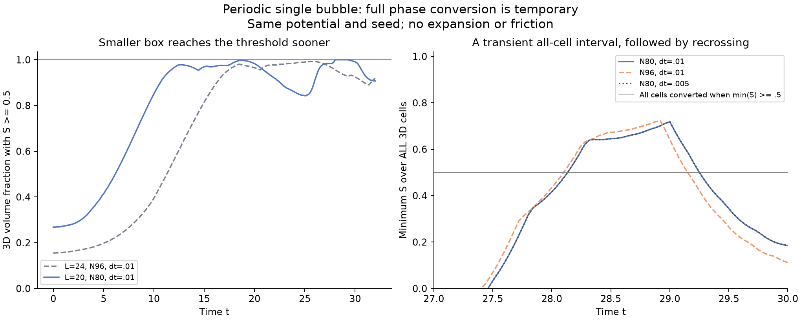
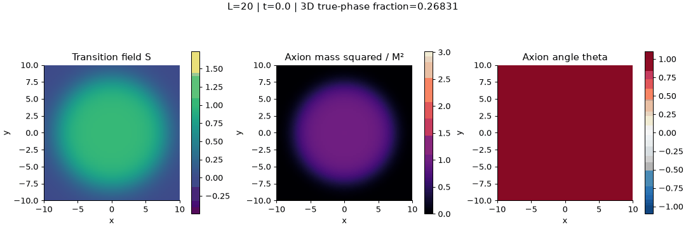

# Smaller periodic boxes: full conversion is transient

2026-10-19. The user requested a smaller box so the transition could fill it.
We ran L24 and L20 with the same potential and initial radius, then refined
the observed L20 transient in space and time. No friction, expansion, forced
completion or field clipping was introduced. The original isolated L48 run
is preserved.

## What the runs establish

The old L48 run had only 17.05% of cells with S>=.5 at t18. Reducing the
box brings the bubble into contact with its periodic copies and creates
collisions. That is a changed physical geometry, not an isolated-bubble
finite-box correction.

| Case | Box | Grid | dt | Time window | Measured all-cell S>=.5 interval |
|---|---:|---:|---:|---:|---|
| L24 pilot | 24 | 96³ | .02 | 0..32 | none |
| L24 finer timestep | 24 | 96³ | .01 | 0..32 | none |
| L20 pilot | 20 | 80³ | .01 | 0..32 | 28.16..29.24 |
| L20 spatial refinement | 20 | 96³ | .01 | 0..30 | 28.12..29.12 |
| L20 temporal refinement | 20 | 80³ | .005 | 0..30 | 28.16..29.24 |

All fractions are measured across ALL 3D grid cells every .04 time units;
they are not inferred from a central slice or free-growing sphere formula.
The intervals describe saved measurements at this cadence. They do not prove
that all continuum points cross at precisely those same times.

The L24 refined-timestep run peaks at 99.2585% above threshold at t25.44,
then falls to 91.9379% at t32. The L20 pilot reaches 100% briefly, but at
t32 its fraction is 90.74375%. S keeps oscillating, and some cells recross.
The predeclared >=2-time-unit sustained-conversion goal was not reached.
All original reports retain goal_reached=false; the separate passing
refinement report validates the narrower transient-conversion claim only.

"In the true phase" here means the operational threshold S>=.5. It does
not mean S=1, zero momentum, zero gradients or spatially constant axion mass.
After collisions, excursions far from both minima occur. A cell below .5
is not by itself evidence for a long-lived false-vacuum pocket. The reports
also retain the bare-barrier fraction, global S range, mean/variance and
fraction |S-1|<.1 to expose this distinction. Since m_a²=M² S², a large
negative S excursion is not a massless false vacuum either.

## Inputs and initial geometry

Same canonical S,A=f theta, v=c=1; lambda=2, DeltaV=.06, M=.5, f=.2;
U=lambda S²(1-S)²/4+DeltaV(1-4S³+3S⁴), cosine axion coupling
f² M² S²[1-cos(A/f)] and full reciprocal force. Initial S is
[1-tanh((r-8)/2)]/2 centred in the box; theta_i=1 and both initial
velocities zero. The box is periodic in every direction. No random seed.

The initial tails matter in these smaller boxes: at the nearest face they
are S=.017986 for L24 and .119203 for L20. Those tails and the derivative
mismatch of the periodic nearest-image profile are retained. L20 is already
an interacting periodic configuration from the outset; its .1 contour does
not fit within the half-box. It cannot be advertised as an isolated initial
bubble with a validated pre-collision spherical wall.

All simulations use actual CosmoLattice PV2, nearest-neighbor spatial force
and compatible forward-gradient energy, double precision, one CPU thread,
history every .04, central slices every .2, full initial/final 3D states.
See [L24 contract](../../SMALL_BOX_EXPERIMENT.md),
[L20 follow-up contract](../../SMALL_BOX_FOLLOWUP.md) and
[transient refinement contract](../../SMALL_BOX_REFINEMENT.md).

## Validation and retained failures

The rebuilt driver adds passive global-phase statistics only. The prior
small homogeneous/inhomogeneous DOP853 checks pass, and all six reference
final states match the previous executable exactly. Independent snapshot
energies and global phase statistics match the native diagnostics.

The L24 dt=.02 pilot missed the .005 energy-drift/excess gate (measured
.00679); its N64 control did too. The dt=.01 L24 reference passes every
local numerical gate, with essentially unchanged phase history. The original
L24 report still has passed=false and no completion times. Comparing N64
with N96 changes final axion energy by 4.29%, and the final threshold fraction
by .00633; this is a pilot sensitivity check, not a continuum proof.

The original L20 pilot passed energy, exchange and independent snapshot gates
but failed the inapplicable pre-collision spherical-width gate: no such window
exists initially. That failed report remains unchanged. A separate prospective
contract tested transient completion directly in the interacting periodic state.
Both L20 refinements pass its energy, phase-statistics, exchange, interval-time
and energy-comparison gates. The spatial completion-window shift is .04 at
the start and .12 at the end; halving the timestep reproduces the original
saved interval. These controls support transient completion, not relaxation
or an exact spatial continuum limit. No thresholds were lowered.

To study a settled final state, a separately specified energy-loss model
(for example expansion or coupling to a dissipative bath) would be needed
to test relaxation. Such physics has not been added in these experiments.
Shrinking the box alone does not enforce a permanent mass switch.

## Evidence

Full evidence is kept in fresh output folders:

- `outputs/stochastic_v2/phase-backend-validation-01/`
- `outputs/stochastic_v2/small-box-completion-01/`
- `outputs/stochastic_v2/smaller-box-followup-01/`
- `outputs/stochastic_v2/smaller-box-refinement-01/`

Compact copies: [L24 original report](l24_report.json),
[L20 original report](l20_report.json),
[L20 transient validation](refinement_report.json),
[L24 refined history](l24_history.csv), [L20 history](l20_history.csv), and
[plot summary/provenance](summary.json). The first L24 rendering is preserved
in ../small-box-completion-01; the refined-step L24 rendering is in
../small-box-completion-02. The main figure here compares global statistics
and resolves the transient interval. No simulation outputs were overwritten.
