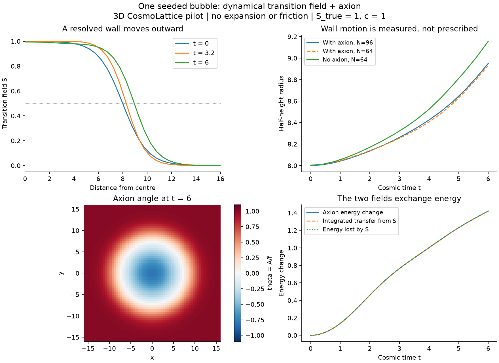
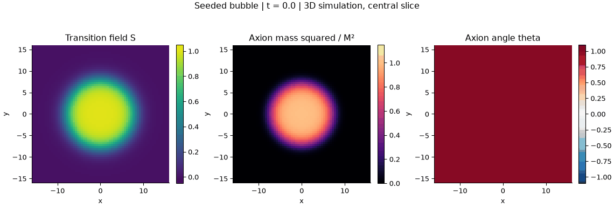

# First dynamical bubble: completed pilot

2026-10-19. The seeded true-vacuum bubble expands, its evolving S field
generates the axion mass, and the axion begins oscillating inside. Both fields
evolve and backreact in actual 3D CosmoLattice PV2. No wall speed is prescribed.
All declared numerical pilot checks pass. This is a finite-time effective-model
demonstration, not a cosmological prediction or a proven spatial continuum limit.





## Physical setup

See [the prospective contract](../../EXPERIMENT.md). Canonical fields S,A;
theta=A/f. U=lambda S²(1-S)²/4+DeltaV(1-4S³+3S⁴) and
V_A=f² M² S²[1-cos(A/f)]. lambda=2, DeltaV=.06, M=.5, f=.2;
excursion v=1 and c=1. The massless false vacuum is S=0, and U's true
vacuum is S=1. At the imposed initial theta=1, the full true minimum is
S=.9946087 rather than exactly 1. The axion force on S is included.

Periodic L=48 cube, initial radius 8, tanh width parameter 2, both fields
initially at rest. Initial theta=1 throughout space; the empty control has
theta=0. The seed is imposed, not a bounce solution or a tunnelling event.
Minkowski cosmic time 0..6, dt=.02, scalar diagnostics every .08, central
slice every .4, initial/final full 3D states. No expansion, bath or friction.
Radius uses the interpolated S=.5 crossing along a central coordinate axis,
corrected for the cell-centred transverse offset. Other axes are checked too.

## What happened

| Quantity | With axion N64 | With axion N96 | Empty N64 |
|---|---:|---:|---:|
| Initial radius, interpolated | 8.00302 | 8.00008 | 8.00302 |
| Final radius at t=6 | 8.93108 | 8.95028 | 9.15610 |
| Initial axion energy | 7.49225 | 7.49225 | 0 |
| Final axion energy | 8.92651 | 8.91294 | 0 |

At matched N64, the bubble with an axion expands less than the empty control.
This demonstrates feedback in this chosen model over this time window; the
empty-control effect has not received a separate full spatial-refinement study.
The axion gains energy while the S sector loses the corresponding amount.
This includes conversion of false-vacuum energy, wall dynamics and the imposed
initial seed, not a universal axion-production efficiency. Initial axion energy
is already nonzero inside the seeded bubble.

The initially broad wall narrows and then widens; it is not a translated fixed
tanh. On N96 its 10%-90% width remains at least 7.015 cells at the saved times.
There is one outward crossing at each threshold in every saved central profile.
Equal radii on three coordinate axes reflect the cubic symmetry; they alone
do not prove angular isotropy away from those axes.

## Numerical evidence

- Homogeneous and spatially varying N4 states agree with independent DOP853.
  Finest dt=.005 max component errors are 2.42e-8 and 3.14e-8, with successive
  error ratios approximately 4. An independent Hamiltonian-gradient check has
  relative discrepancy 7.75e-11. Initial transfer is exact.
- N48 dt=.04,.02,.01 endpoint scaled max-field differences are 2.655e-5 and
  6.637e-6; ratio 4.00047. No physical parameters change in this comparison.
- N64-to-N96 final radius differs by .2145%, final axion energy by .1522%.
  This is a pilot sensitivity check, not a demonstrated spatial order.
- N96 maximum total-energy drift divided by the magnitude of the initial
  excess over uniform false-vacuum energy is 4.244e-6; divided by the raw
  total it is 2.049e-8. Both normalizations are retained.
- Integrated axion exchange residual on N96 is 3.878e-5 of initial axion
  energy. Independently computed snapshot energies match native diagnostics
  within the declared 1e-11 relative gate. The empty axion stays exactly zero.
- Increasing the box from L48,N64 to L60,N80 at the same dx and dt changes
  endpoint local scaled RMS fields in r<15 by 5.17e-13; the measured radius
  is unchanged. This is a finite-time boundary control.

The seven bubble/control subprocesses took about 23.4 seconds altogether,
with OMP_NUM_THREADS=1 and single-thread numerical library settings. Existing
OpenMP-capable CPU framework libraries were reused; no third-party files were
edited. Two dedicated single-translation-unit builds took about 9 seconds
each. The first build preceded a slice-output storage improvement; the
second is the validated executable. The first validation launch rejected a
mistyped evolver name (VV2); it was corrected to PV2 before any field evolution.
The rejected attempt remains under backend-validation-01. No numerical gate
was weakened after inspecting results.

## Files and reproduction

The compact [report](report.json), [backend checks](backend_validation.json),
[N96 history](N96_history.csv), [empty control history](empty_N64_history.csv)
and [timings](timing.json) are saved here. Plot provenance links these figures
to the raw report. The first rendering is preserved in ../single-bubble-01;
this rendering clarifies the field-value normalization in the title.

Full evidence, source snapshots and raw binary states:
`outputs/stochastic_v2/single-bubble-01/`. Independent references and checks:
`outputs/stochastic_v2/backend-validation-02/`. Dedicated build manifest:
`build/stochastic-v2-bubble-02/build.json`.

From the repository root, using fresh destinations:

```sh
python3 checks/stochastic_v2/build_backend.py --output build/stochastic-v2-bubble-new
python3 checks/stochastic_v2/validate_backend.py \
  --executable build/stochastic-v2-bubble-new/bubble_evolve \
  --output outputs/stochastic_v2/backend-validation-new
python3 checks/stochastic_v2/run_bubble.py \
  --executable build/stochastic-v2-bubble-new/bubble_evolve \
  --validation outputs/stochastic_v2/backend-validation-new/report.json \
  --output outputs/stochastic_v2/single-bubble-new
MPLCONFIGDIR=/tmp/afopt-mpl python3 checks/stochastic_v2/plot_bubble.py \
  --source outputs/stochastic_v2/single-bubble-new \
  --output checks/stochastic_v2/results/single-bubble-new
```

No terminal velocity, stochastic population, plasma signal, relic abundance,
or thin-wall accuracy relative to the old prescribed-front calculation is
established. A matched prescribed-front comparison is a useful next research
step, after discussing what the present profiles and exchange mean.
