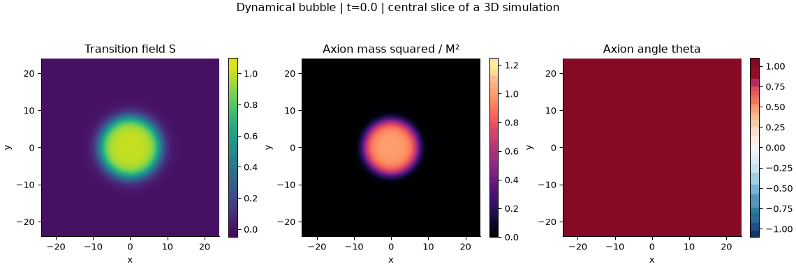
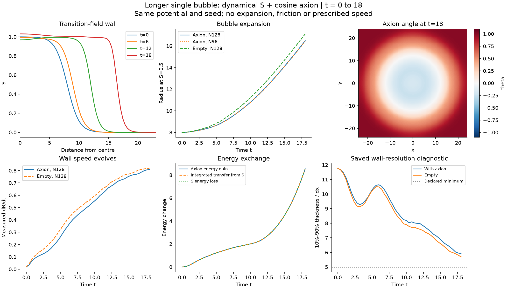

# Longer single-bubble evolution, t=0..18

The subsequent [energy-budget and legacy-comparison analysis](../energy-comparison-02/README.md)
plots all energy components from these saved histories without new field runs.

2026-10-19. The same seeded bubble and coupled-field model now evolve three
times longer than the original t<=6 pilot. The main grid is refined to N128.
All evolution controls pass. A strict native energy-summation check initially
failed in the largest box; the unchanged gate passes with compensated native
endpoint replay. Both the original failure and repair evidence are retained.





## Inputs

The [complete input list](../../INPUT_PARAMETERS.md) includes units, kinetic
normalization, all physical coefficients, initial fields, numerical settings,
thread settings, native metadata and measurement definitions. The exact
[machine-readable registry](parameters.json) is copied from the run. Its
numerical values were checked against all five native input files.

Main inputs: lambda=2, DeltaV=.06, M=.5, f=.2, v=c=1; R0=8, tanh width
parameter w=2, theta0=1, both initial field velocities zero. L=48, N=128,
dx=.375, dt=.04, t=0..18, periodic 3D, double precision, CosmoLattice PV2.
History cadence .08 and central-slice cadence .4. No expansion, plasma,
friction or imposed wall speed. The axion force on S is included. The seed
is imposed at t=0; this does not simulate tunnelling.

## Measured outcome

| Case | N | L | dt | Final radius | Final axion energy |
|---|---:|---:|---:|---:|---:|
| Main | 128 | 48 | .04 | 16.48435 | 16.03776 |
| Coarser spatial grid | 96 | 48 | .04 | 16.43682 | 15.98515 |
| Half timestep | 128 | 48 | .02 | 16.48406 | 16.03675 |
| Empty control | 128 | 48 | .04 | 17.11558 | 0 |
| Larger box, fixed dx | 160 | 60 | .04 | 16.48435 | 16.03777 |

The main radius grows from 7.99959 to 16.48435. The last .4-time-unit
interval gives a wall-speed estimate .80895 c. This is a measured interval
speed, not an imposed or terminal velocity. The empty bubble grows farther.
The axion energy increases from 7.49225 to 16.03776, with the S sector
providing the corresponding energy. This is not a relic density or a universal
conversion efficiency. Initial energy already includes the seeded bubble and
the axion mass inside it.

The wall narrows as it accelerates. Main and empty saved central profiles
have unique outward .1/.5/.9 crossings and minimum 10%-90% widths of 5.905
and 5.698 cells respectively, above the predeclared 5-cell threshold. These
saved-profile diagnostics do not prove a full 3D spatial continuum limit.

## Controls and accuracy

The [prospective contract](../../LONG_EXPERIMENT.md) was saved before runs.
Physical parameters, continuum seed and timestep are fixed in the spatial
comparison; physical parameters, seed, grid and box are fixed in the time
comparison. The larger box uses the same dx and matching cell centres.

- Rebuilt backend homogeneous/inhomogeneous references pass independent
  DOP853 and second-order temporal tests before the longer runs.
- Halving dt changes endpoint radius by .001728%, axion energy by .006306%,
  and full-state RMS by 2.029e-5 in fixed [1,f,1,f] component scales.
- N96-to-N128 endpoint radius changes by .2883% and axion energy by .3280%.
  This two-grid proximity is not a measurement of spatial convergence order.
- Increasing L48/N128 to L60/N160 changes local endpoint state RMS in r<20
  by 7.962e-6 in the same fixed scales. Radius changes by 2.04e-9 relative;
  global axion energy changes by 6.95e-7 relative.
- Main maximum total-energy drift / absolute initial excess above uniform
  false-vacuum energy is 9.990e-4 (.0999%). At half dt it is 2.499e-4,
  consistent with second-order time error. Raw-total normalization is also
  retained in the report; no large background is used to hide drift.
- Main axion exchange residual is 7.349e-5 of initial axion energy; half dt
  gives 3.851e-5. The empty axion remains exactly zero. Initial transfer is
  exact for all five cases.

## Diagnostic failure and repair

The original [long report](original_report.json) has passed=false because
the largest-box independent snapshot energy disagreed with its native sum by
2.069e-11 relative, beyond the unchanged 1e-11 gate. Every other gate passed.
The original driver used naive accumulation declared as long double; on this
Apple ARM platform that does not supply extra precision over double.

Only diagnostic reductions were changed to the existing Neumaier compensated
sum; equations, force evaluation, timestep, initial data and integrator were
unchanged. A new build and independent reference validation pass. All six
small-reference final states match the old executable exactly. Source comparison
also verifies that only the diagnostic accumulator declaration and its include
changed in evolve.cpp.

The saved long-run final states were then loaded unchanged into the compiled
corrected driver. Its initial-time measurement replays each endpoint. All
transfers are exact and independent/native component energies agree to
1.365e-16 relative or better. Replay runs take one subsequent step solely to
use the validated driver interface; those steps are not appended to or used
to replace any long trajectory. See the passing [diagnostic audit](diagnostic_audit.json).
The old histories and failed report remain unchanged. The repair is confined
to endpoint accounting; compensated full-time histories were not regenerated.

## Evidence and reproduction

Full original runs and source snapshots:
`outputs/stochastic_v2/single-bubble-long-01/`. Original rebuilt reference:
`outputs/stochastic_v2/long-backend-validation-01/`. Corrected backend:
`build/stochastic-v2-long-accurate-01/`; independent validation:
`outputs/stochastic_v2/long-accurate-validation-01/`; saved endpoint replays:
`outputs/stochastic_v2/long-diagnostic-replay-01/`.

The five long subprocesses took 343.45 seconds altogether, one CPU thread
each. Endpoint replay cost about 4 seconds altogether. No third-party or
other-workspace sources were changed. The old t<=6 evidence is preserved.

Compact files here: [parameters](parameters.json), [original report](original_report.json),
[repair audit](diagnostic_audit.json), [main history](main_history.csv),
[empty history](empty_history.csv), [timings](timings.json), and plot provenance.

To repeat with the corrected diagnostic backend, use fresh destinations:

```sh
python3 checks/stochastic_v2/build_backend.py --output build/stochastic-v2-long-new
python3 checks/stochastic_v2/validate_backend.py \
  --executable build/stochastic-v2-long-new/bubble_evolve \
  --output outputs/stochastic_v2/long-validation-new
python3 checks/stochastic_v2/run_long_bubble.py \
  --executable build/stochastic-v2-long-new/bubble_evolve \
  --validation outputs/stochastic_v2/long-validation-new/report.json \
  --output outputs/stochastic_v2/single-bubble-long-new
MPLCONFIGDIR=/tmp/afopt-mpl python3 checks/stochastic_v2/plot_long_bubble.py \
  --source outputs/stochastic_v2/single-bubble-long-new \
  --output checks/stochastic_v2/results/single-bubble-long-new
```

No further time extension, terminal-speed model, stochastic ensemble, plasma
signal, abundance or demonstrated continuum limit follows from this experiment.
